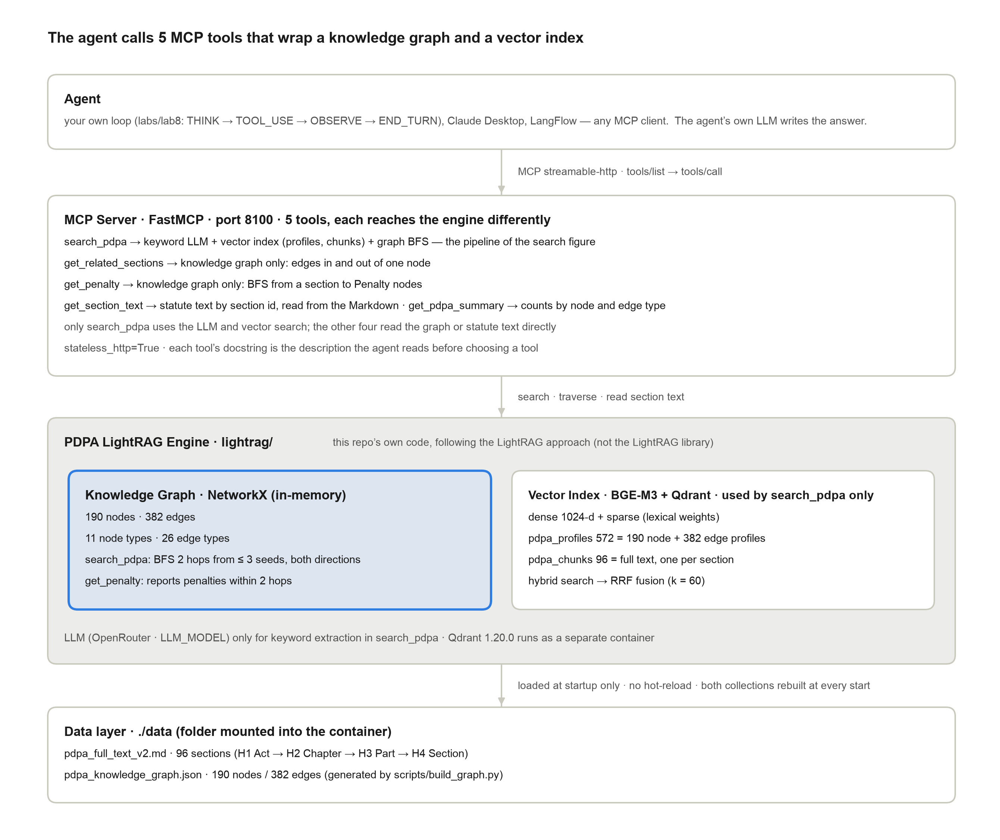
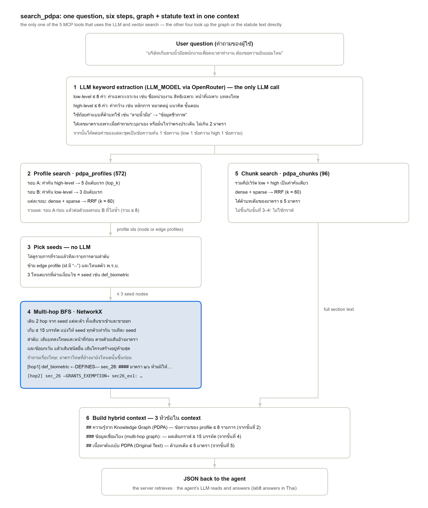

# PDPA GraphRAG + MCP (teaching version, v2)

[ภาษาไทย](README.md)

A GraphRAG agent over Thailand's Personal Data Protection Act (PDPA, B.E. 2562 / 2019).
The 96 sections of the statute become a 190-node / 382-edge knowledge graph plus a dense + sparse
vector index, exposed as five MCP tools that any agent can call. Everything runs locally with
Docker.

This repository is the version used in the GraphRAG course. It continues
[aekanun2020/pdpa-graphrag-mcp](https://github.com/aekanun2020/pdpa-graphrag-mcp), the companion code
for the article series **"Why Vector RAG Answers Only Half of a Legal Question"**, which is now
archived. The original shows the system exactly as the articles describe it; this one fixes the
defects found in a pre-course review (see [What changed from the original](#what-changed-from-the-original)),
so its search results differ from the runs shown in the articles.

Statutes do not repeat themselves, they *point* to other sections: a prohibition lives in one section,
its exceptions in sub-clauses, and the penalty in a later chapter, in a sentence that only says "whoever
violates Section 26". Vector search finds the prohibition, the first half of the answer; the exceptions
and penalties are the second half and are found by walking the graph.

The example is Thai law, but the structure is the same for GDPR, HIPAA, the CCPA or Japan's APPI,
and the embedding model is multilingual.

**Day-1 labs of the course**

- LAB 1, install the system: section [LAB 1: Quick start](#lab-1-quick-start)
- LAB 2, analyse the graph file: section [LAB 2](#lab-2-reading-and-analysing-the-graph-file) and the [step-by-step output](docs/lab2-walkthrough.md) (in Thai)
- LAB 3, build the graph: section [LAB 3: Rebuilding and validating the graph](#lab-3-rebuilding-and-validating-the-graph) and the [step-by-step output](docs/lab3-walkthrough.md) (in Thai)

**Day-2 labs in the course**

- LAB 4, test the MCP tools with curl: section [LAB 4](#lab-4-testing-the-mcp-tools-with-curl)

## What changed from the original

| Area | Original | This version |
|---|---|---|
| Fresh image build | Installs mcp 2.x, which removed `FastMCP`; the container crashes at import and restarts in a loop | `mcp[cli]` pinned below 2 |
| `get_section_text` | Read the graph node's `text`, cut at 3,000 characters: Section 26 lost its biometric-data and criminal-record paragraphs | Reads the full section from the Markdown |
| Statute Markdown | 801 split sara-am from PDF extraction ("ก าหนด", "จ าคุก") | Repaired ("กำหนด", "จำคุก"); graph node text is repaired at load time |
| Node profiles | Built from `description` only, which 33 of 190 nodes have; a Section profile held just its id and relation names | Also read `name_th`, `term_th`, `definition`, `title_th` and `text` |
| Section embedding | `max_length=512`; 7 sections are longer (Section 26 is 810 tokens) and lost their tail | `CHUNK_MAX_LENGTH`, default 1024 |
| RRF constant | Not set, so Qdrant's default k = 2 | `RRF_K`, default 60 |
| Result order | RRF scores tie often and Qdrant does not order ties, so the same keywords gave different seeds per call | Fused candidates are sorted by (score, id); the same keywords give the same context |
| Seed selection | Took the top 3 profiles, then dropped edge profiles: possibly no seed at all | Drops edge profiles and the Act node (`PDPA_2562`) first, then takes 3 |
| `build_graph.py` | Truncated section text at 3,000 characters | Preserves all 96 sections, excluding chapter/part headings, closing material and OCR page labels |

- The shipped graph in `data/` and the output of `build_graph.py` are byte-for-byte identical, with
  190 nodes / 382 edges, and the file's `metadata` is computed from the graph.
- `get_penalty` reports Penalty nodes up to 2 hops away, and only some sections have a Penalty node
  (see item 4 under [Known limitations](#known-limitations)).
- The graph-walk part of the `search_pdpa` context has at most 15 lines.

## What's inside

```
mcp_server_rag.py        FastMCP server (streamable-http, port 8100) exposing 5 tools
lightrag/                retrieval engine: Markdown chunker, NetworkX graph, BGE-M3 + Qdrant index, hybrid retrieval
data/
  pdpa_full_text_v2.md   the statute as Markdown (H1 Act -> H2 Chapter -> H3 Part -> H4 Section)
  pdpa_knowledge_graph.json   pre-built graph: 190 nodes / 382 edges, 11 node types, 26 edge types
scripts/
  build_graph.py         builds the graph with regexes and hand-curated lists; no LLM
  validate_graph.py      counts nodes/edges from the data, checks connectivity and penalty reachability
labs/
  core/                  minimal MCP client (httpx), tool registry (MCP inputSchema -> OpenAI tools), LLM client
  lab2/explore_graph.py reads and analyses the graph file: node and edge types, instances, a walk from a section to its penalty (no server needed)
  lab8/agent_pdpa_mcp.py an agent loop wired to this MCP server
examples/mcp_curl.sh     talk to the server with plain curl + jq
docs/                    architecture and pipeline figures
Dockerfile, docker-compose.yml, .env.example
requirements.txt, constraints.txt   server libraries and their pinned versions (used when building the image)
requirements-agent.txt              agent-side libraries for running labs/lab8
README.md, LICENSE
```

- [LAB 2 graph](data/pdpa_knowledge_graph.json), [LAB 2 script](labs/lab2/explore_graph.py) and [statute text, all 96 sections](data/pdpa_full_text_v2.md)
- [LAB 3 graph builder](scripts/build_graph.py) and [graph validator](scripts/validate_graph.py)
- [MCP server](mcp_server_rag.py), [Docker Compose](docker-compose.yml), [LAB 8 agent](labs/lab8/agent_pdpa_mcp.py) and [curl smoke test](examples/mcp_curl.sh)
- [Architecture figure](docs/fig1_architecture.png), [search pipeline figure](docs/fig3_search_pipeline.png) and [figure generator](docs/figures/make_figures.py)

`labs/` contains the LAB 2 script and the agent-side code for LAB 8; the course slides are not part of this repo; the step-by-step output of LAB 2 and LAB 3 is in `docs/`.

## Architecture



Both figures are drawn by the [Matplotlib script](docs/figures/make_figures.py) to show
190 nodes / 382 edges and Qdrant's 572 profiles / 96 chunks. The architecture figure was re-rendered
on 20 Nov 2026 and the search pipeline figure on 21 Nov 2026.

- **Knowledge graph**: NetworkX, in memory. 190 nodes of 11 types: Section 96, Exemption 33, Definition 11,
  Chapter 9, Right 8, LawfulBasis 7, Obligation 7, Principle 7, Penalty 6, Part 5 and Law 1. The backbone
  edges are `REFERENCES_SECTION` (124, section cites section) and `CONTAINS_SECTION` (119).
- **Vector index**: BGE-M3 (dense 1024-d + sparse lexical weights) in Qdrant with RRF fusion
  (k = 60, set with `RRF_K`; needs Qdrant server and client 1.16+, otherwise Qdrant's default k = 2 applies).
  Two collections: `pdpa_chunks` (96 chunks, one full section per chunk) and `pdpa_profiles`
  (572 = 190 node profiles + 382 edge profiles). Each profile is a short text that lets vector
  search find graph nodes and relationships.
- **MCP server**: FastMCP, `stateless_http=True`. Each tool's docstring is the description the agent
  reads before choosing a tool.
- **LLM on the server side** (configured by `LLM_MODEL` through OpenRouter; `.env.example` sets it to `gpt-oss-120b`, the model the author uses) is used for exactly one thing, extracting search keywords. Answers are
  written by the agent's own model: *the server retrieves, the agent reasons.*

<a id="quick-start"></a>

## LAB 1: Quick start

Requirements: Docker with Compose and an [OpenRouter](https://openrouter.ai) API key.

- **Docker memory:** give Docker at least 8 GB and avoid running other memory-heavy containers next to it.
  Startup peaked at 4.8 GB in our measurement (while embedding the statute text) and settles at about 3–3.7 GB
  (measured with `docker stats` on 20 Nov 2026 on a fresh install from the zip).
  With too little memory the container is killed during startup (the log shows `Killed`, or the status is
  `Restarting (137)`).
- **Disk:** the built image is about 18 GB as reported by Docker (measured on an ARM Mac with Docker Desktop).
  Most of it is torch and its dependencies, plus BGE-M3 (~2.3 GB), which is baked in at build time so the
  container starts offline.
- **Pinned versions:** `requirements.txt` and `constraints.txt` fix every Python package, the `Dockerfile` uses
  Python 3.11.18 and compose uses Qdrant 1.20.0. This is the set the author tested with.
- **Not pinned:** the BGE-M3 weights, downloaded from Hugging Face at build time (tested snapshot `5617a9f6`),
  and system packages from apt.
- **Install test from the zip:** done on 14 Nov 2026 against the earlier 380-edge graph. A fresh build from
  the repo zip returned search contexts identical to the author's when given the same keywords. It has not
  been repeated with the 382-edge graph of 18 Nov 2026.

**The graph ships with the repo:** [`data/pdpa_knowledge_graph.json`](data/pdpa_knowledge_graph.json)
(190 nodes / 382 edges) is in the zip; you do not build it before running. The server loads it at startup
from the `data/` folder mounted into the container. `scripts/build_graph.py` (LAB 3) writes to `build/`,
so it does not affect the running system.

**What happens at every server start:** the server reads two files from `data/`: `pdpa_knowledge_graph.json`
(the graph) and `pdpa_full_text_v2.md` (the statute text). It then deletes both existing Qdrant collections
and creates them again: `pdpa_profiles` with 572 entries from the graph's nodes and edges, and `pdpa_chunks`
with 96 entries, one per section of the statute. Nothing is duplicated, but everything is embedded again
at every start.

**What a profile is:** one piece of search text per node or edge. Real examples, with every field
explained, are in [docs/profiles.md](docs/profiles.md) (in Thai).

```bash
cp .env.example .env            # put your OPENROUTER_API_KEY in .env
docker compose up --build       # starts Qdrant + the MCP server; the first build downloads BGE-M3
```

This command keeps the terminal busy showing the log. Leave it running and open a new terminal in the
same folder for the commands in the next steps.

Startup is done when the log shows:

```
Parsed 96 sections (มาตรา), 96 chunks
Upserted 572 profile vectors
Upserted 96 chunk vectors
```

Smoke test with curl (needs `jq`):

```bash
./examples/mcp_curl.sh
```

If you write your own curl command and get `-32600 Not Acceptable: Client must accept application/json`,
the server is alive but the request lacks an `Accept` header that includes `application/json`, which the
streamable-http transport requires. The `mcp_curl.sh` script already sends
`Accept: application/json, text/event-stream`.

Run the agent against the server:

```bash
python -m venv .venv && source .venv/bin/activate
pip install -r requirements-agent.txt
python labs/lab8/agent_pdpa_mcp.py "เก็บข้อมูลสุขภาพพนักงานได้ไหม ถ้าฝ่าฝืนมีโทษอะไร"
```

The statute and the agent's system prompt are in Thai, so Thai questions work best (the model
answers in Thai; change `SYSTEM` in `labs/lab8/agent_pdpa_mcp.py` to answer in another language).
The agent uses `deepseek/deepseek-v4.1-flash` through OpenRouter, the `OPENROUTER_MODEL` value in `.env.example`.
Expect the number and order of tool calls to vary between runs: the server-side keyword LLM and the agent's
model are not deterministic.

## MCP tools

| Tool | What it does |
|---|---|
| `search_pdpa(query, top_k=5)` | Finds the sections relevant to a question. Always the first tool to call, and the only tool that calls the LLM.<br>**Steps:** LLM extracts keywords -> profile search -> 2-hop BFS -> chunk search -> builds the context<br>**Result:** JSON with the keywords and a `context` for the agent to answer from<br>**Input:** `query` is a question or search phrase in Thai; `top_k` is the number of profiles retrieved with the high-level keywords |
| `get_related_sections(section_id)` | Finds the nodes directly connected to a section in the graph (1 hop). The result is a list of nodes in two groups: nodes this section points to, and nodes that point to this section. Each node comes with its relation type. Use it after `search_pdpa` to find exceptions, rights, duties, penalty sections and the sections to read next.<br>**Input:** a section id, e.g. `sec_26` |
| `get_penalty(section_id)` | Finds the penalties for a violated section by following graph edges from that section, both incoming and outgoing, up to 2 hops. The result is the Penalty nodes found.<br>**Input:** the violated section, e.g. `sec_26`, not the section that sets the penalty |
| `get_section_text(section_id)` | Reads the full text of one section, exactly by the id given, with no semantic search: `sec_27` always returns section 27. Use it before citing a section number or the text of the law in an answer.<br>**Result:** the text of that section from the Markdown file; if no section has that id, `found: false`<br>**Input:** a section id, e.g. `sec_27`; the bare number `27` also works |
| `get_pdpa_summary()` | Gives an overview of the data in the system. Use it to check that the server loaded everything, and for overview questions such as how many sections or chapters the PDPA has.<br>**Result:** total nodes and edges (190 and 382), counts by node type and edge type, and the number of profiles and chunks in the vector index (572 and 96)<br>**Input:** none |

Section ids are `sec_<number>` with Arabic digits (`sec_26`), even though the statute text uses Thai
numerals (มาตรา ๒๖).

## How retrieval works



1. The server-side LLM (configured by `LLM_MODEL`, set to `gpt-oss-120b` in `.env.example`) splits the question into at most 8 low-level keywords (specific terms:
   named rights, duties, penalties) and at most 6 high-level keywords (principles, concepts), after LightRAG's
   dual-level scheme. This is the only step that calls an LLM.
2. Profile search (`pdpa_profiles`, dense + sparse, RRF) runs twice: the high-level query asks for 5 results
   (`top_k`), the low-level query for 3. High-level results come first, followed by low-level results not already
   present, at most 8 in all.
3. Seed selection: walk that list in order, skip edge profiles (ids containing `--`) and the Act node (`PDPA_2562`),
   whose neighbours are only chapters, and take the first 3 nodes left. A skipped node can still appear in the
   context; it is just not a starting point for the graph walk. No LLM is involved.
4. BFS from the seeds, 2 hops, following edges in both directions. At most 15 reached nodes go into the
   context, and every seed gets an equal share. The order of selection depends on the edge type:
   - First: penalty edges (`PRESCRIBES_PENALTY`) and obligation edges (`IMPOSES_OBLIGATION`)
   - Second: cross-reference edges and exemption edges
   - Third: other edge types
   - Last: structural edges (chapter/part), chosen only when there is room left
   - Special case: when the question or its keywords mention a penalty, sections of the penalty chapter
     that reference a reached node (e.g. `sec_83` referencing `sec_37`) also come first

   Each node is written as
   `[hop1] def_biometric ←DEFINES— sec_26: ...`: the left node is where the walk came from and the arrow
   follows the edge's direction in the graph, so the model can read a path from the seed step by step.
5. Chunk search (`pdpa_chunks`) fetches the full text of up to 5 sections, using both keyword levels combined.
   It does not use the graph result.
6. The context is assembled from the three parts (at most 8 profiles, 15 graph lines, 5 full sections) and
   returned as JSON. The server never writes the answer.

### How this differs from LightRAG

This repo adapts ideas from [LightRAG](https://arxiv.org/abs/2410.05779); it does not use LightRAG's code.
The `lightrag/` folder in this repo is five files written for this project. It is not the LightRAG package, and
this repo does not install that package.
The comparison below is against the paper and the [HKUDS/LightRAG](https://github.com/HKUDS/LightRAG) code at
commit `221215e` (read on 22 Nov 2026).

**The same**

- The question is split into two keyword levels, low-level and high-level.
- Both nodes and edges of the graph get a short search text (called a profile in this repo).
- The graph itself is stored apart from the vector database, in NetworkX (also LightRAG's default).

**Different**

| Topic | LightRAG | This repo |
|---|---|---|
| Building the graph | An LLM extracts entities and relationships from the documents | Rules (regex and lists in the script), no LLM |
| Where node and edge search texts live | Two separate stores | One collection, `pdpa_profiles` |
| What each keyword level searches | Low-level searches nodes only; high-level searches edges only | Both levels search nodes and edges |
| Search text of an edge | Keywords the LLM wrote when it extracted the edge, plus the edge description | The edge type name and the ids of its two nodes |
| Use of the graph after a hit | One step further: the edges attached to a found node, or the two end nodes of a found edge | A 2-hop BFS from up to 3 seed nodes, ranked by edge type |
| Chunk search | Uses the full question (`mix` and `naive` modes) | Uses both keyword levels combined |

Three of these differences (where the search texts live, what each keyword level searches, and the search
text of an edge) are why edge profiles in this repo are almost never returned; see
[docs/profiles.md](docs/profiles.md) (in Thai). The 2-hop walk is an addition of this repo, made to reach
penalties that sit two edges away from the section a question starts from.

The LightRAG side was read from sections 3.1 and 3.2 of the paper and from the parts of the code that declare
the stores and run the search. LightRAG was not run, and its code may change after the date above.

The four reasons this repo has its own engine instead of the LightRAG package are in
[docs/why-not-lightrag.md](docs/why-not-lightrag.md) (in Thai).

## LAB 2: reading and analysing the graph file

[`labs/lab2/explore_graph.py`](labs/lab2/explore_graph.py) reads [`data/pdpa_knowledge_graph.json`](data/pdpa_knowledge_graph.json) and prints six steps.
It only reads the file: no server and no API key are needed. Steps 1–5 use the Python standard library only.
Step 6 uses `networkx`; if it is not installed, the script skips that step and says how to install it.
The script prints its output in Thai.

```bash
python3 labs/lab2/explore_graph.py                # start the walk at section 41
python3 labs/lab2/explore_graph.py --section 26   # start at another section
python3 labs/lab2/explore_graph.py --step 3       # show step 3 only
```

On Windows use `python` instead of `python3`. The script writes UTF-8 on every platform.

Output of every step, with images (in Thai): [docs/lab2-walkthrough.md](docs/lab2-walkthrough.md)

| Step | What it prints |
|---|---|
| 1 | node and edge counts taken from the data, next to the `metadata` block (190 / 382) |
| 2 | the 11 node types, how many nodes each has, and their property names |
| 3 | the 26 relationship types, how many edges each has, and the source and target node types |
| 4 | the full record of node `PDPA_2562` and of the edge from `PDPA_2562` to `ch3` |
| 5 | edges into and out of the chosen section, and paths to a Penalty node within 2 hops |
| 6 | the edge attributes after loading into NetworkX |

In the JSON file `source` and `target` are properties of an edge. Step 6 shows that after loading into NetworkX
they become the two ends of the edge, so the edge attributes that remain are `relationship` and `order`.

<a id="rebuilding-and-validating-the-graph"></a>

## LAB 3: Rebuilding and validating the graph

Run these in the venv created under "LAB 1: Quick start". `build_graph.py` uses only the Python standard
library; `validate_graph.py` also needs `networkx`.

```bash
pip install networkx                     # used only by validate_graph.py
python scripts/build_graph.py            # -> build/ (never overwrites data/)
python scripts/validate_graph.py         # checks data/pdpa_knowledge_graph.json
python scripts/validate_graph.py build/pdpa_knowledge_graph.json
cmp build/pdpa_knowledge_graph.json data/pdpa_knowledge_graph.json   # prints nothing = byte-identical
```

[`build_graph.py`](scripts/build_graph.py) uses no LLM and needs no API key; it is entirely
rule-based. One regex finds section headings in
[`pdpa_full_text_v2.md`](data/pdpa_full_text_v2.md), and another finds cross-references inside each
section (`REFERENCES_SECTION` edges). Semantic nodes (definitions, rights, obligations, penalties,
exemptions, principles, lawful bases) are curated lists in the script, including 33 exemption
nodes (6 for Section 4 and 27 for Sections 24, 26, 28 and 37), 6 `IS_LAWFUL_BASIS` edges and 4 `REFERENCES_EXEMPTION` edges. The script
builds 190 nodes / 382 edges. `Section.text` ends before the next Markdown heading or the closing
signature and explanatory note. Standalone OCR page labels are removed before
splitting the sections; in the source file they appear misspelled as `้หนา ๖๐` (the Thai word for
"page" with its tone mark out of place). Outputs go to `build/` and can be checked with
[`validate_graph.py`](scripts/validate_graph.py).

[`.env.example`](.env.example) has `USE_LLM_EXTRACT` (default `false`), which lets an LLM extract extra nodes
when the server starts. The shipped graph and all labs do not use it.

The LAB 2 graph in [`data/pdpa_knowledge_graph.json`](data/pdpa_knowledge_graph.json) and the LAB 3
output `build/pdpa_knowledge_graph.json` are byte-for-byte identical, including ordering and
`metadata` (190 nodes / 382 edges / 26 edge types). This graph provides 572 profiles, and the
Markdown provides 96 chunks.

Output of every step, with images (in Thai): [docs/lab3-walkthrough.md](docs/lab3-walkthrough.md)

To use this on another statute, swap the heading pattern (`Article\s+(\d+)` for GDPR,
`第([一二三四五六七八九十百]+)条` for Japan's APPI) and re-curate the semantic nodes.

## LAB 4: Testing the MCP tools with curl

This lab talks to the MCP server directly with `curl`, without an agent, so you can see the JSON-RPC requests and responses of `tools/list` and `tools/call`.

You need: this repo's folder, `curl` and `jq`, and an MCP server that is ready, either the one you started in
[LAB 1: Quick start](#lab-1-quick-start) or one the instructor opened for the class.
If you use the instructor's server, set its URL once in the terminal you will use for the lab:

```bash
export MCP_SERVER_URL=<URL from the instructor>/mcp
```

**Step 1: run the script.** [`examples/mcp_curl.sh`](examples/mcp_curl.sh) sends 3 requests: `tools/list`, `get_penalty` for section 26, and `search_pdpa`.

```bash
./examples/mcp_curl.sh
```

Expected: 5 tool names, 2 penalties for `sec_26`, and `keywords` with at most 8 `low_level` and at most 6 `high_level` entries.
The `search_pdpa` part of the script prints only `keywords`; it does not show the context the server returns.

**Step 2: call `search_pdpa` yourself and save the whole result to a file.** Step 3 uses this file. The `build/` folder is not tracked by git.

```bash
mkdir -p build
curl -s -X POST "${MCP_SERVER_URL:-http://localhost:8100/mcp}" \
  -H "Content-Type: application/json" \
  -H "Accept: application/json, text/event-stream" \
  -d '{"jsonrpc":"2.0","id":1,"method":"tools/call","params":{"name":"search_pdpa","arguments":{"query":"เก็บข้อมูลชีวภาพ ลายนิ้วมือ ข้อมูลอ่อนไหว","top_k":5}}}' \
  | jq '.result.content[0].text | fromjson' > build/lab4_search.json
jq '{keywords, profile_results_count, chunk_results_count}' build/lab4_search.json
```

The last command prints the keywords, the number of profiles (`profile_results_count`) and the number of full section texts (`chunk_results_count`).
This step makes one LLM call for keyword extraction, so it takes longer than the other commands (two test runs took 7 and 42 seconds).

**Results differ from run to run:** the keywords come from an LLM, which is not deterministic, so the keyword counts, the number of profiles and the order of sections can differ from a classmate's or from the slides.

**If `low_level` is the question itself and `high_level` is empty,** the server's LLM call failed in that run and the server used the question split on spaces instead of keywords.
The server reports no error in this case. Run the command again; if it stays the same, check `OPENROUTER_API_KEY` in `.env`.

**Step 3: look at the 3 parts of the context.** This step makes no further server calls. Extract the context into a text file and list the headings of its parts:

```bash
jq -r '.context' build/lab4_search.json > build/lab4_context.txt
grep -n '^## \|^### ' build/lab4_context.txt
```

| Part | Heading in the file (in Thai) | Which step of [How retrieval works](#how-retrieval-works) it comes from |
|---|---|---|
| 1 | `## ความรู้จาก Knowledge Graph (PDPA)` | the profiles found (retrieval step 2); each entry starts with `- ` followed by a node id |
| 2 | `### ข้อมูลเชื่อมโยง (multi-hop graph):` | graph traversal from the seeds (retrieval steps 3 and 4); each line starts with `[hop1]` or `[hop2]` |
| 3 | `## เนื้อหาต้นฉบับ PDPA (Original Text)` | full text of the sections found (retrieval step 5) |

Parts 1 and 3 come from semantic (vector) search and part 2 from graph traversal, so the context is hybrid.

How to read a line of part 2: `[hop1] sec26_ex1 ←GRANTS_EXEMPTION— sec_26` means the walk went from node `sec26_ex1` to `sec_26` in 1 hop
over a `GRANTS_EXEMPTION` edge. The arrow follows the edge's direction in the graph; here the edge points from `sec_26` to `sec26_ex1`, so the walk went against the arrow.

On Windows, run every command of this lab in Git Bash (not tested on Windows).

## Known limitations

- Built for one statute. The graph lives in memory and both Qdrant collections are deleted and created again on
  every server start (no hot reload). For a corpus of laws use a graph database; `build_graph.py` also emits
  `pdpa_neo4j_import.cypher`.
- Rule-based graph construction means porting to a new law is curation work, not configuration.
- There is no standard evaluation set yet. Testing so far has been the author's internal testing, with questions
  written during development, and none of it has been reviewed by a lawyer. Contributions of question/answer pairs with expected section
  citations are welcome.
- The shipped graph has a known gap in its penalty data that affects `get_penalty` for Section 26:
  only Sections 77, 79, 85, 86 and 90 have a Penalty node, so `get_penalty('sec_26')` returns the two
  criminal penalties of Section 79 and no administrative fine. This is the subject of part 2 of the
  article series and is left as is until that article is published.
- The keyword LLM is the remaining source of run-to-run variation: at temperature 0 the same question
  still produced two different keyword sets in four calls, and each set gives its own context.
- The keyword prompt invites the LLM to guess section numbers, and the guesses can be wrong.
- Edge profiles (382 of the 572) are embedded from identifiers only, so search almost never returns
  them: 2 of 488 profile entries across 70 recorded searches. Details in
  [docs/profiles.md](docs/profiles.md) (in Thai).

## Data

The statute text is the Personal Data Protection Act B.E. 2562 (2019), a public document, prepared
from the version published by the Office of the Council of State of Thailand. The knowledge graph,
code and figures are by the author.

The structure of the statute file `data/pdpa_full_text_v2.md` (its four heading levels, the shape of a
section, and the line numbers of every chapter) and the code that reads it are described in
[docs/statute-file.md](docs/statute-file.md) (in Thai).

## Article series

Written for the original repository; the runs they show come from the original code.

1. Why Vector RAG Answers Only Half of a Legal Question (Thai: https://aekanunbigdata.medium.com/a0f1e09e3450 — English version coming)
2. One missing edge: why the agent cited the wrong penalty section (coming)
3. Why a GraphRAG agent needs a fifth tool (coming)
