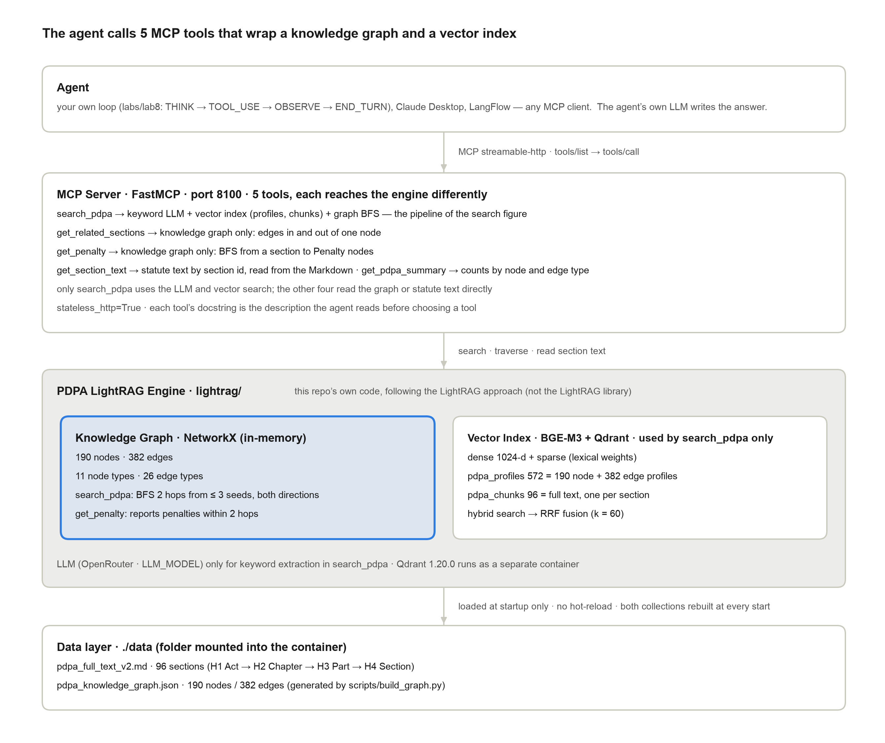
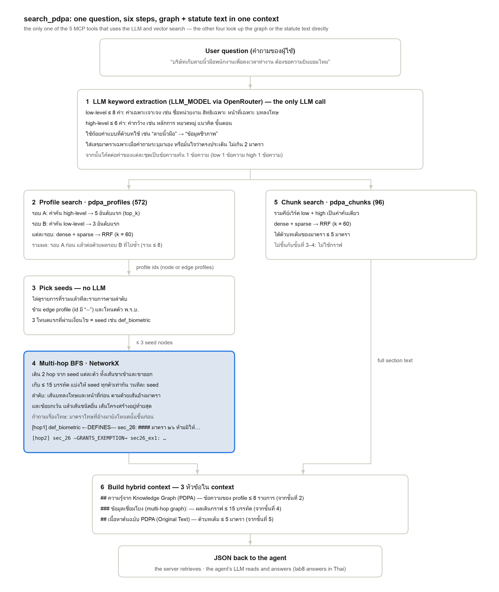

# PDPA GraphRAG + MCP (ฉบับใช้สอน, v2)

[English](README.en.md)

GraphRAG agent สำหรับพระราชบัญญัติคุ้มครองข้อมูลส่วนบุคคล พ.ศ. 2562 (PDPA)
ตัวบท 96 มาตราถูกแปลงเป็น knowledge graph ขนาด 190 โหนด 382 เส้น คู่กับ vector index แบบ dense + sparse
แล้วเปิดให้ agent ใดก็ได้เรียกใช้ผ่าน MCP tool 5 ตัว ทุกอย่างรันบนเครื่องด้วย Docker

repo นี้คือฉบับที่ใช้ในคอร์ส GraphRAG ต่อยอดจาก
[aekanun2020/pdpa-graphrag-mcp](https://github.com/aekanun2020/pdpa-graphrag-mcp)
ซึ่งเป็นโค้ดประกอบบทความชุด **"Why Vector RAG Answers Only Half of a Legal Question"** และถูก archive แล้ว
repo เดิมแสดงระบบตามที่บทความเขียนไว้ทุกประการ ส่วน repo นี้แก้ข้อบกพร่องที่พบจากการทบทวนก่อนสอน
(ดู [สิ่งที่ต่างจาก repo เดิม](#สิ่งที่ต่างจาก-repo-เดิม)) ผลการค้นจึงต่างจากตัวอย่างในบทความ

ตัวบทกฎหมายไม่เขียนเรื่องเดียวกันซ้ำ แต่ใช้วิธี*อ้างถึง*มาตราอื่น: ข้อห้ามอยู่ในมาตราหนึ่ง ข้อยกเว้นอยู่ในอนุมาตรา
ส่วนบทลงโทษอยู่ในหมวดท้าย ๆ ในประโยคที่บอกเพียงว่า "ผู้ใดฝ่าฝืนมาตรา 26"
vector search หามาตราที่เป็นข้อห้ามเจอ ซึ่งเป็นครึ่งแรกของคำตอบ ส่วนข้อยกเว้นและบทลงโทษเป็นครึ่งหลัง ต้องหาด้วยการเดินกราฟ

ตัวอย่างเป็นกฎหมายไทย แต่โครงสร้างเดียวกันใช้ได้กับ GDPR, HIPAA, CCPA หรือ APPI ของญี่ปุ่น
และ embedding model ที่ใช้รองรับหลายภาษา

## สิ่งที่ต่างจาก repo เดิม

| เรื่อง | repo เดิม | repo นี้ |
|---|---|---|
| build image ใหม่ | ติดตั้งได้ mcp 2.x ซึ่งเอา `FastMCP` ออก container ล้มตอน import แล้ววน restart | ตรึง `mcp[cli]` ต่ำกว่า 2 |
| `get_section_text` | อ่าน field `text` ของโหนดในกราฟ ซึ่งถูกตัดที่ 3,000 ตัวอักษร ม.26 จึงขาดวรรคข้อมูลชีวภาพและวรรคประวัติอาชญากรรม | อ่านตัวบทเต็มจาก Markdown |
| ตัวบท Markdown | สระอำแตก 801 แห่งจากการแปลง PDF ("ก าหนด", "จ าคุก") | แก้แล้ว ("กำหนด", "จำคุก") และแก้ตัวบทในกราฟตอนโหลด |
| node profile | สร้างจาก `description` อย่างเดียว ซึ่งมีแค่ 33 จาก 190 โหนด profile ของมาตราจึงมีแค่ id กับชื่อความสัมพันธ์ | อ่าน `name_th`, `term_th`, `definition`, `title_th` และ `text` ด้วย |
| embedding ของมาตรา | `max_length=512` มี 7 มาตราที่ยาวกว่านี้ (ม.26 ยาว 810 token) ส่วนท้ายจึงหาย | `CHUNK_MAX_LENGTH` ค่าเริ่มต้น 1024 |
| ค่า k ของ RRF | ไม่ได้ตั้ง จึงใช้ค่าเริ่มต้นของ Qdrant คือ k = 2 | `RRF_K` ค่าเริ่มต้น 60 |
| ลำดับผลค้น | คะแนน RRF เท่ากันบ่อยและ Qdrant ไม่กำหนดลำดับของคะแนนที่เท่ากัน คีย์เวิร์ดชุดเดิมจึงได้ seed ต่างกันในแต่ละครั้ง | เรียงผลรวมด้วย (คะแนน, id) คีย์เวิร์ดชุดเดิมได้ context เหมือนเดิม |
| การเลือก seed | ตัด profile 3 อันดับแรกก่อน แล้วค่อยทิ้ง edge profile จึงอาจไม่เหลือ seed เลย | ทิ้ง edge profile และโหนดตัว พ.ร.บ. (`PDPA_2562`) ก่อน แล้วค่อยเลือก 3 |
| `build_graph.py` | ตัดตัวบทของมาตราที่ 3,000 ตัวอักษร | เก็บตัวบทครบ 96 มาตรา โดยแยกหัวข้อหมวด/ส่วน ข้อความท้ายกฎหมาย และเลขหน้า OCR ออก |

- กราฟสำเร็จรูปใน `data/` กับผลที่ `build_graph.py` สร้างใหม่ ตรงกันทั้งไฟล์ มี 190 โหนด / 382 เส้น
  และ `metadata` ในไฟล์นับจากกราฟจริง
- `get_penalty` รายงานโหนด Penalty ที่อยู่ห่างไม่เกิน 2 hop และกราฟมีโหนด Penalty เฉพาะบางมาตรา
  (ดูข้อที่ 4 ใน [ข้อจำกัดที่ทราบ](#ข้อจำกัดที่ทราบ))
- ส่วนผลเดินกราฟใน context ของ `search_pdpa` มีไม่เกิน 15 บรรทัด

## ใน repo มีอะไรบ้าง

```
mcp_server_rag.py        FastMCP server (streamable-http, port 8100) เปิด tool 5 ตัว
lightrag/                retrieval engine: ตัด Markdown, กราฟ NetworkX, index BGE-M3 + Qdrant, hybrid retrieval
data/
  pdpa_full_text_v2.md   ตัวบทในรูป Markdown (H1 พ.ร.บ. -> H2 หมวด -> H3 ส่วน -> H4 มาตรา)
  pdpa_knowledge_graph.json   กราฟสำเร็จรูป: 190 โหนด / 382 เส้น, โหนด 11 ประเภท, เส้น 26 ประเภท
scripts/
  build_graph.py         สร้างกราฟด้วย regex และรายการที่คัดเลือกด้วยมือ ไม่ใช้ LLM
  validate_graph.py      นับโหนด/เส้นจากข้อมูลจริง ตรวจการเชื่อมต่อและการเดินไปถึงบทลงโทษ
labs/
  core/                  MCP client ขนาดเล็ก (httpx), tool registry (MCP inputSchema -> OpenAI tools), LLM client
  lab2/explore_graph.py อ่านและวิเคราะห์ไฟล์กราฟ: ชนิดของโหนดและเส้น, instance, เดินจากมาตราถึงโทษ (ไม่ต้องเปิด server)
  lab8/agent_pdpa_mcp.py agent loop ที่ต่อเข้ากับ MCP server นี้
examples/mcp_curl.sh     คุยกับ server ด้วย curl + jq
docs/                    รูปสถาปัตยกรรมและ pipeline
Dockerfile, docker-compose.yml, .env.example
requirements.txt, constraints.txt   ไลบรารีของ server และรุ่นที่ตรึงไว้ (ใช้ตอน build image)
requirements-agent.txt              ไลบรารีฝั่ง agent สำหรับรัน labs/lab8
README.en.md, LICENSE
```

- [กราฟสำหรับ LAB 2](data/pdpa_knowledge_graph.json), [สคริปต์ของ LAB 2](labs/lab2/explore_graph.py) และ [ตัวบท 96 มาตรา](data/pdpa_full_text_v2.md)
- [ตัวสร้างกราฟสำหรับ LAB 3](scripts/build_graph.py) และ [ตัวตรวจกราฟ](scripts/validate_graph.py)
- [MCP server](mcp_server_rag.py), [Docker Compose](docker-compose.yml), [agent ของ LAB 8](labs/lab8/agent_pdpa_mcp.py) และ [ทดสอบด้วย curl](examples/mcp_curl.sh)
- [ภาพสถาปัตยกรรม](docs/fig1_architecture.png), [ภาพขั้นตอนค้น](docs/fig3_search_pipeline.png) และ [สคริปต์สร้างภาพ](docs/figures/make_figures.py)

`labs/` มีสคริปต์ของ LAB 2 และโค้ดฝั่ง agent ของ LAB 8 เอกสารประกอบ lab ของคอร์สไม่ได้อยู่ใน repo นี้

## สถาปัตยกรรม



- **Knowledge graph**: NetworkX อยู่ในหน่วยความจำ มี 190 โหนด 11 ประเภท คือ Section 96, Exemption 33,
  Definition 11, Chapter 9, Right 8, LawfulBasis 7, Obligation 7, Principle 7, Penalty 6, Part 5 และ Law 1
  เส้นหลักคือ `REFERENCES_SECTION` (124 เส้น มาตราอ้างถึงมาตรา) และ `CONTAINS_SECTION` (119 เส้น)
- **Vector index**: BGE-M3 (dense 1024 มิติ + sparse แบบ lexical weights) ใน Qdrant รวมผลด้วย RRF
  (k = 60 ตั้งได้ด้วย `RRF_K` ต้องใช้ Qdrant server และ client รุ่น 1.16 ขึ้นไป ถ้าต่ำกว่านั้นจะใช้ค่าเริ่มต้นของ Qdrant คือ k = 2)
  มีสอง collection คือ `pdpa_chunks` (96 chunks จากตัวบทเต็ม 96 มาตรา มาตราละหนึ่ง chunk)
  และ `pdpa_profiles` (572 รายการ = 190 node profiles + 382 edge profiles)
  แต่ละ profile เขียนเป็นข้อความสั้น ๆ เพื่อให้ vector search ค้นเจอโหนดและความสัมพันธ์ในกราฟได้
- **MCP server**: FastMCP, `stateless_http=True` docstring ของแต่ละ tool คือคำอธิบายที่ agent อ่านก่อนเลือกใช้
- **LLM ฝั่ง server** (กำหนดด้วย `LLM_MODEL` ผ่าน OpenRouter ซึ่ง `.env.example` ตั้งเป็น `gpt-oss-120b`) ใช้ทำอย่างเดียว คือแตกคีย์เวิร์ดสำหรับค้น คำตอบเขียนโดยโมเดลของ agent เอง:
  *server ค้น ส่วน agent คิดและตอบ*

รูปทั้งสองสร้างด้วย [สคริปต์ Matplotlib](docs/figures/make_figures.py)
ให้ตรงกับกราฟ 190 โหนด / 382 เส้น และ Qdrant 572 profiles / 96 chunks
รูปสถาปัตยกรรมเรนเดอร์ใหม่เมื่อ 20 พ.ย. 2569 ส่วนรูปขั้นตอนค้นเรนเดอร์ใหม่เมื่อ 21 พ.ย. 2569

## เริ่มใช้งาน

สิ่งที่ต้องมี: Docker พร้อม Compose และ API key ของ [OpenRouter](https://openrouter.ai)

- **หน่วยความจำของ Docker:** ตั้งไว้อย่างน้อย 8 GB และไม่ควรมี container อื่นที่ใช้หน่วยความจำมากรันอยู่ด้วย
  ตอนเริ่ม server ใช้สูงสุดที่วัดได้ 4.8 GB (ช่วง embed ตัวบท) แล้วลดลงเหลือราว 3–3.7 GB ตอนทำงานปกติ
  (วัดด้วย `docker stats` เมื่อ 20 พ.ย. 2569 จากการติดตั้งใหม่จาก zip)
  ถ้าหน่วยความจำไม่พอ container จะถูก kill ระหว่างเริ่ม (log ขึ้น `Killed` หรือสถานะ `Restarting (137)`)
- **พื้นที่ดิสก์:** image ที่ build แล้วมีขนาดราว 18 GB ตามที่ Docker รายงาน (วัดบน Mac ชิป ARM, Docker Desktop)
  ส่วนใหญ่เป็น torch กับไลบรารีที่ติดมา และ BGE-M3 ราว 2.3 GB ที่ถูกใส่ไว้ใน image ตอน build
  container จึงเริ่มได้โดยไม่ต้องต่ออินเทอร์เน็ต
- **รุ่นที่ตรึงไว้:** `requirements.txt` กับ `constraints.txt` ตรึงรุ่นไลบรารี Python ทุกตัว `Dockerfile` ใช้ Python 3.11.18
  และ compose ใช้ Qdrant 1.20.0 ชุดนี้คือชุดที่ผู้เขียนใช้ทดสอบ
- **สิ่งที่ไม่ได้ตรึง:** น้ำหนักของ BGE-M3 ซึ่งดาวน์โหลดจาก Hugging Face ตอน build (รุ่นที่ทดสอบคือ snapshot `5617a9f6`)
  และแพ็กเกจของระบบจาก apt
- **การทดสอบติดตั้งจาก zip:** ทำเมื่อ 14 พ.ย. 2569 กับกราฟรุ่นก่อนซึ่งมี 380 เส้น ได้ผลค้นตรงกับเครื่องของผู้เขียนทุกตัวอักษร
  เมื่อใช้คีย์เวิร์ดชุดเดียวกัน ยังไม่ได้ทดสอบซ้ำกับกราฟ 382 เส้นที่แก้เมื่อ 18 พ.ย. 2569

**กราฟมากับ repo แล้ว ไม่ต้องสร้างก่อนรัน:** ไฟล์ [`data/pdpa_knowledge_graph.json`](data/pdpa_knowledge_graph.json)
(190 โหนด / 382 เส้น) อยู่ใน zip และ server โหลดไฟล์นี้ตอนเริ่ม ผ่านโฟลเดอร์ `data/` ที่ mount เข้า container
ส่วน `scripts/build_graph.py` (LAB 3) เขียนผลลง `build/` จึงไม่กระทบระบบที่รันอยู่

**สิ่งที่เกิดทุกครั้งที่ server เริ่ม:** server อ่านไฟล์ 2 ไฟล์จาก `data/` คือ `pdpa_knowledge_graph.json` (กราฟ)
และ `pdpa_full_text_v2.md` (ตัวบท) แล้วลบ collection เดิมของ Qdrant ทั้งสองและสร้างใหม่: `pdpa_profiles` 572 รายการ
จากโหนดและเส้นของกราฟ และ `pdpa_chunks` 96 รายการจากตัวบทรายมาตรา ข้อมูลจึงไม่ซ้ำ แต่ต้อง embed ใหม่ทุกครั้ง

**Profile คืออะไร:** ข้อความสำหรับค้น 1 รายการต่อโหนด 1 ตัวหรือเส้น 1 เส้น ดูตัวอย่างจริงและคำอธิบายทีละช่องใน
[docs/profiles.md](docs/profiles.md)

```bash
cp .env.example .env            # ใส่ OPENROUTER_API_KEY ใน .env
docker compose up --build       # เริ่ม Qdrant + MCP server; build ครั้งแรกจะดาวน์โหลด BGE-M3
```

คำสั่งนี้ค้างหน้าจอไว้เพื่อแสดง log ให้ปล่อย terminal นี้ไว้ แล้วเปิด terminal ใหม่ในโฟลเดอร์เดียวกันสำหรับคำสั่งในขั้นถัดไป

ระบบพร้อมเมื่อ log แสดง:

```
Parsed 96 sections (มาตรา), 96 chunks
Upserted 572 profile vectors
Upserted 96 chunk vectors
```

ถ้า log แสดง `RRF k=60 ใช้ไม่ได้` แปลว่า Qdrant บนเครื่องเก่ากว่า 1.16 ระบบยังทำงานได้ด้วย k = 2

ทดสอบเบื้องต้นด้วย curl (ต้องมี `jq`):

```bash
./examples/mcp_curl.sh
```

ถ้าเขียนคำสั่ง curl เองแล้วได้ `-32600 Not Acceptable: Client must accept application/json` กลับมา แปลว่า server ทำงานอยู่
แต่ request ขาด header `Accept` ที่มี `application/json` ซึ่ง transport แบบ streamable-http บังคับให้มี
สคริปต์ `mcp_curl.sh` ส่ง `Accept: application/json, text/event-stream` ให้แล้ว

รัน agent ต่อเข้ากับ server:

```bash
python -m venv .venv && source .venv/bin/activate
pip install -r requirements-agent.txt
python labs/lab8/agent_pdpa_mcp.py "เก็บข้อมูลสุขภาพพนักงานได้ไหม ถ้าฝ่าฝืนมีโทษอะไร"
```

ตัวบทและ system prompt ของ agent เป็นภาษาไทย คำถามภาษาไทยจึงได้ผลดีที่สุด
(ถ้าต้องการให้ตอบภาษาอื่น แก้ `SYSTEM` ใน `labs/lab8/agent_pdpa_mcp.py`)
agent ใช้โมเดล `deepseek/deepseek-v4.1-flash` ผ่าน OpenRouter ตามค่า `OPENROUTER_MODEL` ใน `.env.example`
จำนวนและลำดับการเรียก tool ต่างไปได้ในแต่ละรอบ เพราะคีย์เวิร์ดจาก LLM ฝั่ง server และคำตอบของโมเดลฝั่ง agent ไม่คงที่

## MCP tools

| Tool | ทำอะไร |
|---|---|
| `search_pdpa(query, top_k=5)` | ค้นหามาตราที่เกี่ยวกับคำถาม ใช้เป็นเครื่องมือแรกเสมอ และเป็นเครื่องมือเดียวที่เรียก LLM<br>**ขั้นตอน:** LLM แตกคีย์เวิร์ด -> ค้น profile -> BFS 2 hop -> ค้น chunk -> ประกอบ context<br>**ผลที่ได้:** JSON ที่มีคีย์เวิร์ด และ `context` สำหรับให้ agent ใช้ตอบ<br>**ค่าที่ต้องใส่:** `query` คือคำถามหรือคำค้นภาษาไทย ส่วน `top_k` คือจำนวน profile ที่ค้นด้วยคีย์เวิร์ด high-level |
| `get_related_sections(section_id)` | หาโหนดที่ต่อกับมาตราหนึ่งโดยตรงในกราฟ (1 hop) ผลที่ได้คือรายการโหนด แยกเป็น 2 กลุ่ม คือโหนดที่มาตรานี้ชี้ไป และโหนดที่ชี้มาหามาตรานี้ แต่ละโหนดมีชนิดความสัมพันธ์กำกับ ใช้ต่อจาก `search_pdpa` เพื่อหาข้อยกเว้น สิทธิ หน้าที่ มาตราโทษ และมาตราที่ควรอ่านต่อ<br>**ค่าที่ต้องใส่:** id ของมาตรา เช่น `sec_26` |
| `get_penalty(section_id)` | หาบทลงโทษของมาตราที่ถูกฝ่าฝืน โดยเดินตามเส้นในกราฟจากมาตรานั้น ทั้งขาเข้าและขาออก ไม่เกิน 2 hop ผลที่ได้คือโหนด Penalty ที่พบ<br>**ค่าที่ต้องใส่:** มาตราที่ถูกฝ่าฝืน เช่น `sec_26` ไม่ใช่มาตราที่กำหนดโทษ |
| `get_section_text(section_id)` | อ่านตัวบทเต็มของมาตราเดียว ตรงตาม id ที่ใส่ ไม่ค้นตามความหมาย ใส่ `sec_27` จึงได้มาตรา 27 เสมอ ใช้ก่อนอ้างเลขมาตราหรือเนื้อหาของกฎหมายในคำตอบ<br>**ผลที่ได้:** ตัวบทของมาตรานั้นจากไฟล์ Markdown ถ้าไม่มีมาตราตาม id จะได้ `found: false`<br>**ค่าที่ต้องใส่:** id ของมาตรา เช่น `sec_27` หรือใส่เลข `27` ก็ได้ |
| `get_pdpa_summary()` | ดูภาพรวมของข้อมูลในระบบ ใช้ตรวจว่า server โหลดข้อมูลครบ และใช้ตอบคำถามภาพรวม เช่น PDPA มีกี่มาตรา กี่หมวด<br>**ผลที่ได้:** จำนวนโหนดและเส้นทั้งหมด (190 และ 382) จำนวนแยกตามชนิดโหนดและชนิดเส้น และจำนวน profile กับ chunk ใน vector index (572 และ 96)<br>**ค่าที่ต้องใส่:** ไม่มี |

id ของมาตราใช้รูป `sec_<เลข>` ด้วยเลขอารบิก (`sec_26`) แม้ตัวบทจะใช้เลขไทย (มาตรา ๒๖)

## การค้นทำงานอย่างไร



1. LLM ฝั่ง server (กำหนดด้วย `LLM_MODEL` ซึ่ง `.env.example` ตั้งเป็น `gpt-oss-120b`) แยกคำถามเป็นคีย์เวิร์ด low-level ไม่เกิน 8 คำ (คำเฉพาะ เช่น ชื่อสิทธิ หน้าที่ บทลงโทษ)
   และ high-level ไม่เกิน 6 คำ (หลักการ แนวคิด) ตามแนวทาง dual-level ของ LightRAG ขั้นนี้เป็นจุดเดียวที่เรียก LLM
2. ค้น profile (`pdpa_profiles`, dense + sparse, RRF) สองรอบ: รอบ high-level ขอ 5 รายการ (`top_k`) และรอบ low-level ขอ 3 รายการ
   นำผลรอบ high-level ขึ้นก่อน แล้วต่อด้วยผลรอบ low-level ที่ยังไม่ซ้ำ ได้ไม่เกิน 8 รายการ
3. เลือก seed: ไล่รายการตามลำดับ ข้าม profile ของเส้น (id มี `--`) และโหนดตัว พ.ร.บ. (`PDPA_2562`) เพราะเพื่อนบ้านมีแต่หมวด
   แล้วหยิบ 3 โหนดแรกที่เหลือ โหนดที่ถูกข้ามยังแสดงใน context ได้ตามปกติ แค่ไม่ใช้เป็นจุดเริ่มเดินกราฟ ขั้นนี้ไม่มี LLM
4. BFS จาก seed 2 hop ตามเส้นทั้งสองทิศ แล้วเลือกไม่เกิน 15 โหนดลง context โดยแบ่งโควตาให้ทุก seed เท่ากัน
   ลำดับการเลือกดูจากชนิดเส้น:
   - อันดับแรก: เส้นบทลงโทษ (`PRESCRIBES_PENALTY`) และเส้นหน้าที่ (`IMPOSES_OBLIGATION`)
   - อันดับสอง: เส้นอ้างข้ามมาตรา และเส้นข้อยกเว้น
   - อันดับสาม: เส้นชนิดอื่น
   - ท้ายสุด: เส้นโครงสร้าง (หมวด/ส่วน) ซึ่งถูกเลือกเมื่อยังมีที่เหลือเท่านั้น
   - กรณีพิเศษ: เมื่อคำถามหรือคีย์เวิร์ดมีคำเรื่องโทษ มาตราในหมวดบทกำหนดโทษที่อ้างมายังโหนดที่เดินถึง
     (เช่น `sec_83` ที่อ้าง `sec_37`) ขึ้นเป็นอันดับแรกด้วย

   แต่ละโหนดถูกเขียนเป็น `[hop1] def_biometric ←DEFINES— sec_26: ...` โหนดซ้ายคือโหนดที่เดินมาจาก
   และลูกศรชี้ตามทิศของเส้นในกราฟ โมเดลจึงอ่านเส้นทางจาก seed ต่อกันเป็นทอด ๆ ได้
5. ค้น chunk (`pdpa_chunks`) ด้วยคีย์เวิร์ดสองระดับรวมกัน ได้ตัวบทเต็มไม่เกิน 5 มาตรา
   ขั้นนี้ไม่ใช้ผลจากกราฟ
6. ประกอบ context จากสามส่วน (profile ไม่เกิน 8 รายการ, ผลเดินกราฟไม่เกิน 15 บรรทัด, ตัวบทเต็มไม่เกิน 5 มาตรา) แล้วส่งกลับเป็น JSON
   server ไม่เขียนคำตอบ

### ต่างจาก LightRAG อย่างไร

repo นี้ดัดแปลงแนวคิดจาก [LightRAG](https://arxiv.org/abs/2410.05779) ไม่ได้ใช้โค้ดของ LightRAG
โฟลเดอร์ `lightrag/` ใน repo นี้เป็นโค้ดที่เขียนขึ้นเอง 5 ไฟล์ ไม่ใช่แพ็กเกจ LightRAG และ repo นี้ไม่ได้ติดตั้งแพ็กเกจนั้น
ตารางนี้เทียบกับ paper และกับโค้ดของ [HKUDS/LightRAG](https://github.com/HKUDS/LightRAG) ที่ commit `221215e` (อ่านเมื่อ 22 พ.ย. 2569)

**ที่เหมือนกัน**

- แตกคำถามเป็นคีย์เวิร์ด 2 ระดับ คือ low-level กับ high-level
- ทำข้อความย่อสำหรับค้นให้ทั้งโหนดและเส้นของกราฟ (repo นี้เรียกว่า profile)
- เก็บกราฟตัวจริงแยกจาก vector db และใช้ NetworkX (เป็นค่าเริ่มต้นของ LightRAG ด้วย)

**ที่ต่างกัน**

| เรื่อง | LightRAG | repo นี้ |
|---|---|---|
| การสร้างกราฟ | ให้ LLM สกัด entity และ relationship จากเอกสาร | ใช้กฎ (regex และรายการในสคริปต์) ไม่ใช้ LLM |
| ที่เก็บข้อความย่อของโหนดและเส้น | แยกเป็น 2 ที่เก็บ | รวมใน collection เดียว คือ `pdpa_profiles` |
| คีย์เวิร์ดแต่ละระดับค้นอะไร | low-level ค้นเฉพาะโหนด และ high-level ค้นเฉพาะเส้น | ทั้งสองระดับค้นทั้งโหนดและเส้น |
| ข้อความค้นของเส้น | คีย์เวิร์ดที่ LLM เขียนให้ตอนสกัดเส้น และคำบรรยายของเส้น | ชื่อชนิดเส้นกับ id ของโหนดสองปลาย |
| การใช้กราฟหลังค้นเจอ | อ่านต่อ 1 ขั้น คือเส้นที่ติดกับโหนดที่เจอ หรือโหนดสองปลายของเส้นที่เจอ | เดิน BFS 2 hop จาก seed ไม่เกิน 3 โหนด และจัดลำดับตามชนิดเส้น |
| การค้น chunk | ค้นด้วยคำถามเต็ม (โหมด `mix` และ `naive`) | ค้นด้วยคีย์เวิร์ดสองระดับรวมกัน |

ข้อแตกต่าง 3 เรื่อง คือที่เก็บข้อความย่อ สิ่งที่คีย์เวิร์ดแต่ละระดับค้น และข้อความค้นของเส้น
ทำให้ profile ของเส้นใน repo นี้แทบไม่ถูกค้นเจอ ดู [docs/profiles.md](docs/profiles.md)
การเดิน 2 hop เป็นสิ่งที่ repo นี้ทำเพิ่ม เพื่อไปให้ถึงบทลงโทษที่อยู่ห่างจากมาตราต้นทาง 2 ทอด

ฝั่ง LightRAG อ่านจาก paper หัวข้อ 3.1 และ 3.2 และจากโค้ดเฉพาะส่วนที่ประกาศที่เก็บกับส่วนที่ค้น
ไม่ได้รัน LightRAG และโค้ดของ LightRAG เปลี่ยนได้หลังวันที่อ่าน

เหตุผล 4 ข้อที่ repo นี้เขียน engine เองแทนการใช้แพ็กเกจ LightRAG อยู่ใน [docs/why-not-lightrag.md](docs/why-not-lightrag.md)

## LAB 2: อ่านและวิเคราะห์ไฟล์กราฟ

[`labs/lab2/explore_graph.py`](labs/lab2/explore_graph.py) อ่าน [`data/pdpa_knowledge_graph.json`](data/pdpa_knowledge_graph.json) แล้วพิมพ์ผล 6 ขั้น
สคริปต์อ่านไฟล์อย่างเดียว ไม่ต้องเปิด server และไม่ต้องมี API key ขั้นที่ 1–5 ใช้เฉพาะไลบรารีมาตรฐานของ Python
ขั้นที่ 6 ใช้ `networkx` ถ้าเครื่องไม่มี สคริปต์จะข้ามขั้นนี้และบอกวิธีติดตั้ง

```bash
python3 labs/lab2/explore_graph.py                # เริ่มเดินจากมาตรา 41
python3 labs/lab2/explore_graph.py --section 26   # เริ่มเดินจากมาตราอื่น
python3 labs/lab2/explore_graph.py --step 3       # ดูเฉพาะขั้นที่ 3
```

บน Windows ใช้ `python` แทน `python3` สคริปต์พิมพ์ผลเป็น UTF-8 ทุกระบบ

ผลของทุกขั้นพร้อมภาพ ดูที่ [docs/lab2-walkthrough.md](docs/lab2-walkthrough.md)

| ขั้น | สิ่งที่พิมพ์ |
|---|---|
| 1 | จำนวนโหนดและเส้นที่นับจากข้อมูล เทียบกับ `metadata` (190 / 382) |
| 2 | Node Type 11 ชนิด จำนวนโหนด และชื่อ property ของแต่ละชนิด |
| 3 | Relationship Type 26 ประเภท จำนวนเส้น และชนิดของต้นทางกับปลายทาง |
| 4 | โหนด `PDPA_2562` และเส้นจาก `PDPA_2562` ไป `ch3` ทั้งแถว |
| 5 | เส้นเข้าและออกของมาตราที่เลือก และเส้นทางถึงโหนดชนิด Penalty ภายใน 2 hop |
| 6 | attribute ของเส้นหลังโหลดเข้า NetworkX |

ในไฟล์ JSON `source` และ `target` เป็น property ของเส้น ขั้นที่ 6 แสดงว่าเมื่อโหลดเข้า NetworkX แล้ว
2 ค่านี้กลายเป็นปลาย 2 ข้างของเส้น attribute ของเส้นจึงเหลือ `relationship` และ `order`

## สร้างและตรวจกราฟใหม่

รันใน venv ที่สร้างไว้ในหัวข้อ "เริ่มใช้งาน" `build_graph.py` ใช้เฉพาะไลบรารีมาตรฐานของ Python
ส่วน `validate_graph.py` ต้องติดตั้ง `networkx` เพิ่ม

```bash
pip install networkx                     # ใช้โดย validate_graph.py เท่านั้น
python scripts/build_graph.py            # -> build/ (ไม่เขียนทับ data/)
python scripts/validate_graph.py         # ตรวจ data/pdpa_knowledge_graph.json
python scripts/validate_graph.py build/pdpa_knowledge_graph.json
```

[`build_graph.py`](scripts/build_graph.py) ไม่ใช้ LLM และไม่ต้องมี API key ทำงานด้วยกฎทั้งหมด: regex ตัวหนึ่งหาหัวมาตราใน
[`pdpa_full_text_v2.md`](data/pdpa_full_text_v2.md) อีกตัวหาการอ้างข้ามมาตรา
(เส้น `REFERENCES_SECTION`) ส่วนโหนดเชิงความหมาย (นิยาม สิทธิ หน้าที่ บทลงโทษ ข้อยกเว้น หลักการ ฐานทางกฎหมาย)
เป็นรายการที่คัดเลือกไว้ในสคริปต์ ในนั้นมีโหนดข้อยกเว้น 33 โหนด (ของมาตรา 4 จำนวน 6 โหนด
และของมาตรา 24, 26, 28, 37 รวม 27 โหนด) เส้น `IS_LAWFUL_BASIS` 6 เส้น
และ `REFERENCES_EXEMPTION` 4 เส้น สคริปต์นี้สร้างกราฟ 190 โหนด / 382 เส้น
`Section.text` สิ้นสุดก่อนหัวข้อ Markdown ถัดไป หรือก่อนข้อความลงนามและหมายเหตุท้ายกฎหมาย
บรรทัดเลขหน้าที่ติดมาจาก OCR จะถูกลบก่อนตัดข้อความของแต่ละมาตรา ในไฟล์ต้นฉบับบรรทัดเหล่านี้สะกดเพี้ยนเป็น `้หนา ๖๐`
(คำว่า "หน้า" ที่วรรณยุกต์สลับตำแหน่ง)
ผลสร้างใหม่อยู่ใน `build/` และตรวจได้ด้วย [`validate_graph.py`](scripts/validate_graph.py)
ไฟล์ [`data/pdpa_knowledge_graph.json`](data/pdpa_knowledge_graph.json) สำหรับ LAB 2 และ
`build/pdpa_knowledge_graph.json` จาก LAB 3 ตรงกันทุกไบต์ รวมลำดับข้อมูลและ `metadata`
ซึ่งระบุ 190 โหนด / 382 เส้น / เส้น 26 ประเภท กราฟนี้ให้ 572 profiles และ Markdown ให้ 96 chunks

ใน [`.env.example`](.env.example) มี `USE_LLM_EXTRACT` (ค่าเริ่มต้น `false`) สำหรับให้ LLM สกัดโหนดเพิ่มตอน server เริ่มทำงาน
กราฟที่ให้มาและทุก LAB ไม่ได้ใช้ทางนี้

ถ้าจะใช้กับกฎหมายฉบับอื่น ให้เปลี่ยน pattern ของหัวข้อ (`Article\s+(\d+)` สำหรับ GDPR,
`第([一二三四五六七八九十百]+)条` สำหรับ APPI ของญี่ปุ่น) แล้วคัดเลือกโหนดเชิงความหมายใหม่

## ข้อจำกัดที่ทราบ

- สร้างมาสำหรับกฎหมายฉบับเดียว กราฟอยู่ในหน่วยความจำ และ collection ทั้งสองของ Qdrant ถูกลบแล้วสร้างใหม่ทุกครั้งที่ server เริ่ม
  (ไม่มี hot reload) ถ้าเป็นคลังกฎหมายหลายฉบับควรใช้ graph database ซึ่ง `build_graph.py` สร้างไฟล์
  `pdpa_neo4j_import.cypher` สำหรับนำเข้า Neo4j ไว้ให้แล้ว
- การสร้างกราฟด้วยกฎแปลว่าการย้ายไปใช้กับกฎหมายใหม่เป็นงานคัดเลือกข้อมูล ไม่ใช่แค่การตั้งค่า
- ยังไม่มีชุดประเมินผลมาตรฐาน การทดสอบที่ทำมาเป็นการทดสอบภายในของผู้เขียน ด้วยชุดคำถามที่เขียนขึ้นระหว่างการพัฒนา
  และยังไม่ผ่านการตรวจโดยนักกฎหมาย
- กราฟที่ให้มาขาดข้อมูลบทลงโทษบางส่วน ซึ่งกระทบผลของ `get_penalty` สำหรับมาตรา 26:
  มีเพียงมาตรา 77, 79, 85, 86 และ 90 ที่มีโหนด Penalty ดังนั้น `get_penalty('sec_26')` คืนโทษอาญา 2 รายการของมาตรา 79
  และไม่มีโทษปรับทางปกครอง เรื่องนี้เป็นหัวข้อของบทความตอนที่ 2 และคงไว้ตามเดิมจนกว่าบทความนั้นจะเผยแพร่
- ความไม่คงที่ระหว่างการรันที่เหลืออยู่มาจาก LLM แตกคีย์เวิร์ด: ที่ temperature 0 คำถามเดียวกันยังได้คีย์เวิร์ด
  2 ชุดจากการเรียก 4 ครั้ง และแต่ละชุดให้ context ของตัวเอง
- prompt แตกคีย์เวิร์ดชวนให้ LLM เดาเลขมาตรา ซึ่งเดาผิดได้
- profile ของเส้น (382 จาก 572) ใช้ข้อความค้นที่เป็นรหัสล้วน จึงแทบไม่ถูกค้นเจอ ในผลค้น 70 ครั้งที่บันทึกไว้
  พบ 2 จาก 488 รายการ รายละเอียดใน [docs/profiles.md](docs/profiles.md)

## ข้อมูล

ตัวบทคือพระราชบัญญัติคุ้มครองข้อมูลส่วนบุคคล พ.ศ. 2562 ซึ่งเป็นเอกสารสาธารณะ
จัดเตรียมจากฉบับที่เผยแพร่โดยสำนักงานคณะกรรมการกฤษฎีกา knowledge graph โค้ด และรูปเป็นของผู้เขียน

โครงสร้างของไฟล์ตัวบท `data/pdpa_full_text_v2.md` (หัวข้อ 4 ระดับ รูปของมาตรา และเลขบรรทัดของทุกหมวด)
และโค้ดส่วนที่อ่านไฟล์นี้ อยู่ใน [docs/statute-file.md](docs/statute-file.md)

## บทความชุด

เขียนสำหรับ repo เดิม ตัวอย่างการรันในบทความมาจากโค้ดเดิม

1. Why Vector RAG Answers Only Half of a Legal Question (ภาษาไทย: https://aekanunbigdata.medium.com/a0f1e09e3450)
2. One missing edge: why the agent cited the wrong penalty section (ยังไม่เผยแพร่)
3. Why a GraphRAG agent needs a fifth tool (ยังไม่เผยแพร่)
