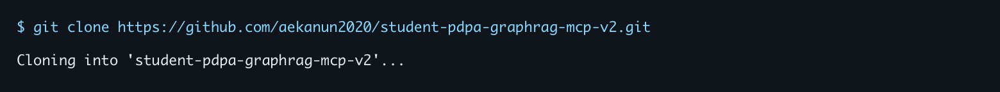
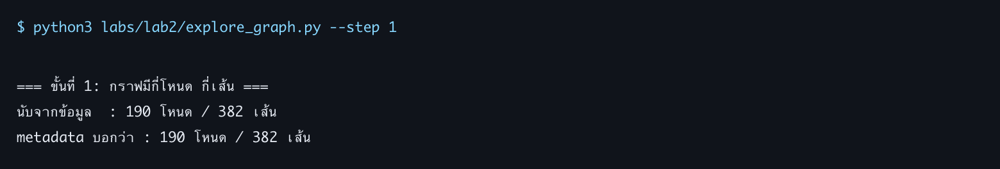
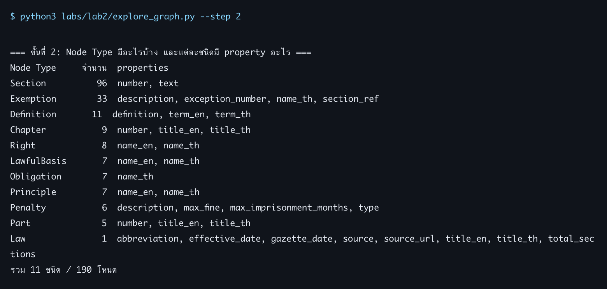
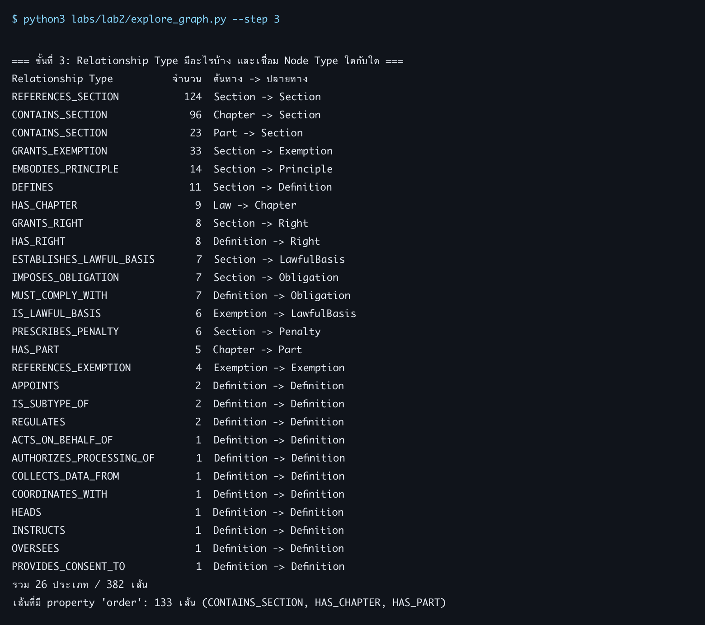
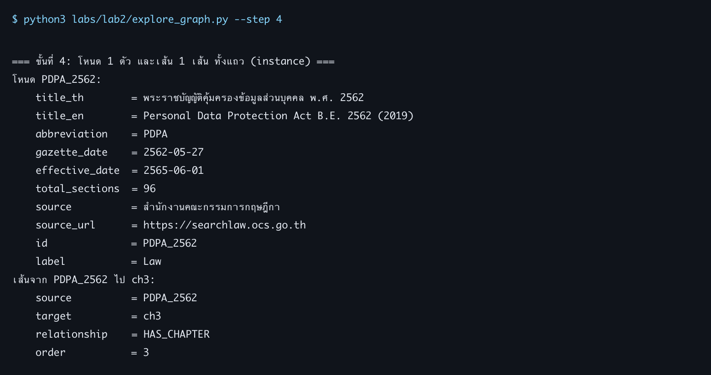
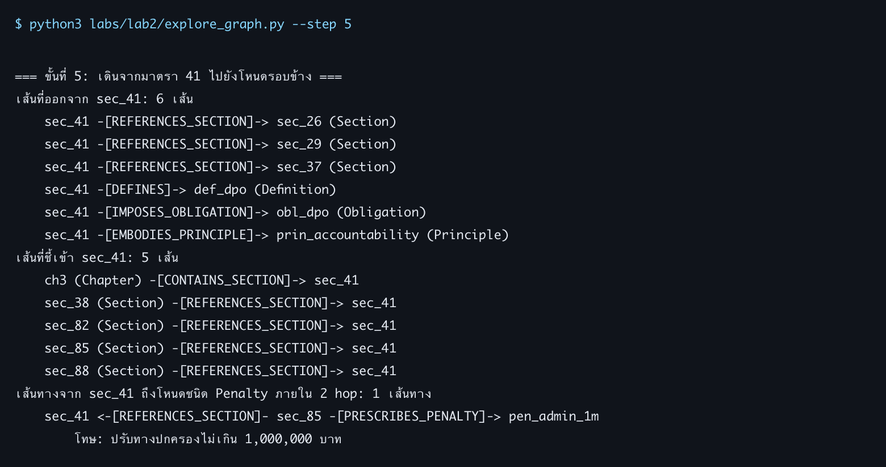
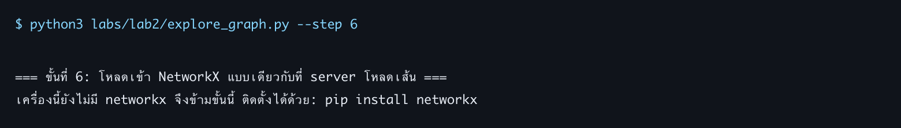
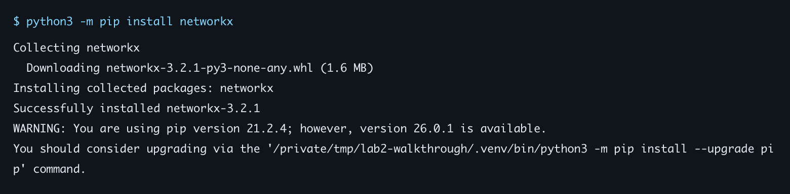
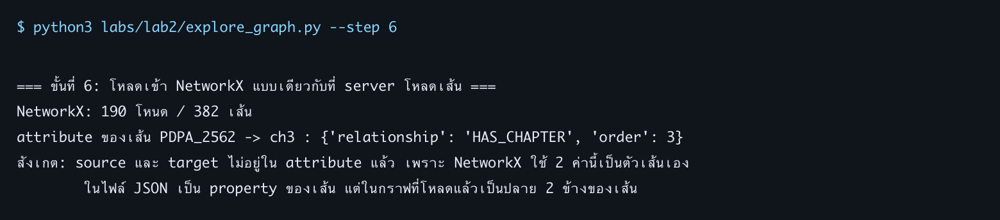

# LAB 2 ทำตามสไลด์ทีละขั้น พร้อมผลที่ได้

เอกสารนี้แสดงผลของการทำ LAB 2 ตามสไลด์ M1 หน้า "Hands-on LAB 2: วิเคราะห์ pdpa_knowledge_graph.json" ทุกขั้น ใช้เทียบกับผลบนเครื่องของคุณได้

- **ทำเมื่อ:** 25 พ.ย. 2569 บน macOS 27.0.1 ด้วย Python 3.9.6 จาก commit [`4143070`](https://github.com/aekanun2020/student-pdpa-graphrag-mcp-v2/commit/4143070) ของ repo นี้
- **ยังไม่ได้ทดสอบบน Windows**
- **ภาพในเอกสารนี้สร้างจากข้อความที่ terminal พิมพ์ออกมาจริง ไม่ใช่ภาพถ่ายหน้าจอ** ตัวอักษรตรงกับผลจริงทุกตัว แต่แนวคอลัมน์ของตารางอาจเหลื่อมจากที่เห็นใน terminal เล็กน้อย
- **Python ที่ใช้:** รันใน virtual environment ใหม่ที่ยังไม่มี `networkx` เพื่อให้เห็นขั้นที่ 6 ทั้งก่อนและหลังติดตั้ง

LAB นี้ไม่ต้องเปิด server และไม่แก้ไฟล์ใดใน repo

## 1. เตรียมโฟลเดอร์ของ repo

ถ้าทำใน LAB 1 แล้ว ข้ามข้อนี้

```sh
git clone https://github.com/aekanun2020/student-pdpa-graphrag-mcp-v2.git
cd student-pdpa-graphrag-mcp-v2
```



## 2. รันสคริปต์ของ LAB 2

คำสั่งในสไลด์คือ

```sh
python3 labs/lab2/explore_graph.py
```

คำสั่งนี้พิมพ์ผลของขั้นที่ 1 ถึง 6 ต่อกันในครั้งเดียว เอกสารนี้แสดงทีละขั้นด้วยตัวเลือก `--step` เพื่อให้อ่านง่าย ผลทีละขั้นเมื่อนำมาต่อกัน ตรงกับผลของการรันครั้งเดียวทุกไบต์

### ขั้นที่ 1: กราฟมีกี่โหนด กี่เส้น

```sh
python3 labs/lab2/explore_graph.py --step 1
```



### ขั้นที่ 2: Node Type มีอะไรบ้าง และแต่ละชนิดมี property อะไร

```sh
python3 labs/lab2/explore_graph.py --step 2
```



### ขั้นที่ 3: Relationship Type มีอะไรบ้าง และเชื่อม Node Type ใดกับใด

```sh
python3 labs/lab2/explore_graph.py --step 3
```



### ขั้นที่ 4: โหนด 1 ตัว และเส้น 1 เส้น ทั้งแถว (instance)

```sh
python3 labs/lab2/explore_graph.py --step 4
```



### ขั้นที่ 5: เดินจากมาตรา 41 ไปยังโหนดรอบข้าง

```sh
python3 labs/lab2/explore_graph.py --step 5
```



### ขั้นที่ 6: โหลดเข้า NetworkX

ถ้าเครื่องยังไม่มี `networkx` สคริปต์จะข้ามขั้นนี้และไม่ error

```sh
python3 labs/lab2/explore_graph.py --step 6
```



ติดตั้ง `networkx` แล้วรันขั้นที่ 6 อีกครั้ง

```sh
python3 -m pip install networkx
python3 labs/lab2/explore_graph.py --step 6
```





## 3. เทียบกับ "ผลที่ควรเห็น" ในสไลด์

| รายการ | สไลด์บอกว่า | ได้จริง | ดูได้ที่ |
|---|---:|---:|---|
| โหนด | 190 | 190 | ขั้นที่ 1 |
| เส้น | 382 | 382 | ขั้นที่ 1 |
| Node Type | 11 ชนิด | 11 ชนิด | ขั้นที่ 2 |
| Relationship Type | 26 ประเภท | 26 ประเภท | ขั้นที่ 3 |

ตัวเลขตรงกันทั้ง 4 รายการ

## 4. คำถามของ LAB 2

คำถาม 4 ข้ออยู่ในสไลด์หน้าถัดจากหน้า LAB 2 คำถาม ก และ ข ใช้ผลของขั้นที่ 3 คำถาม ค ใช้ผลของขั้นที่ 5 เอกสารนี้ไม่มีคำตอบ
