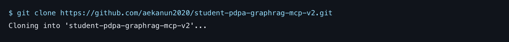
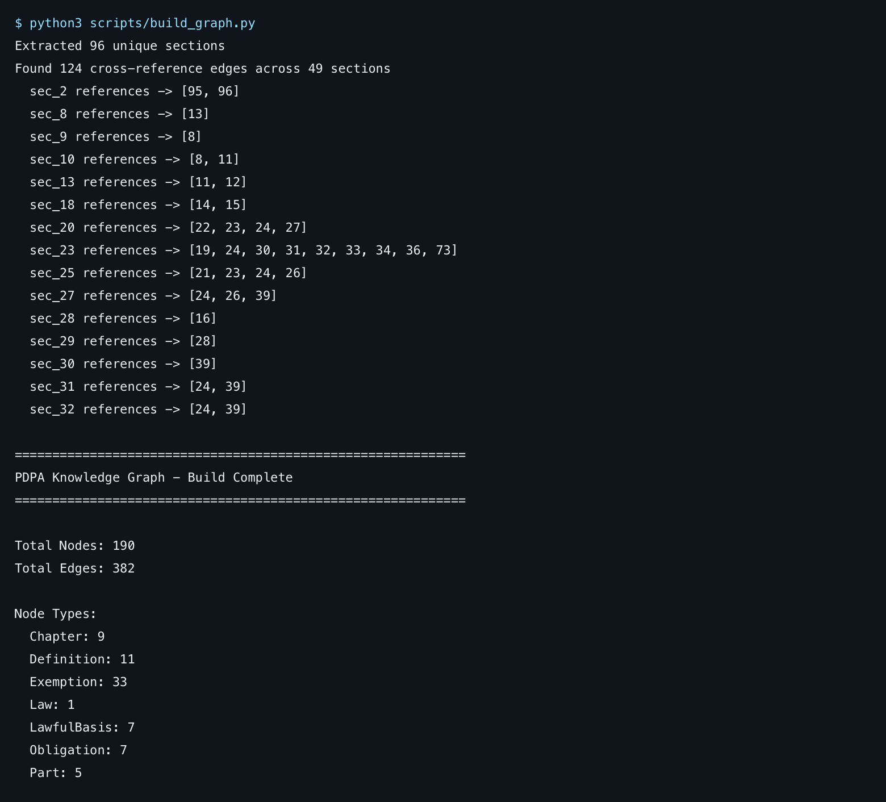
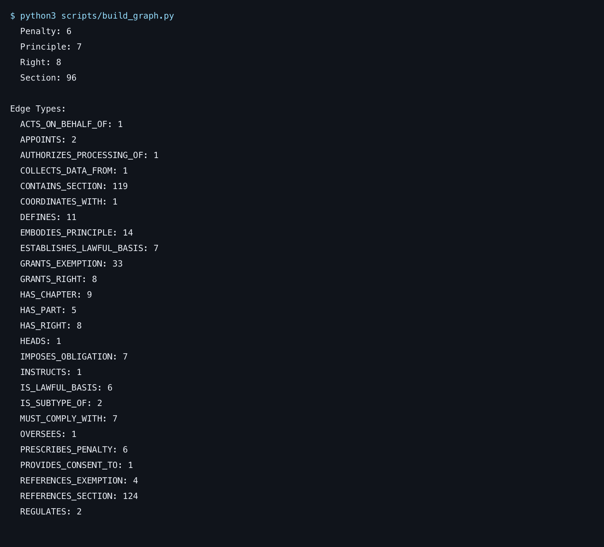
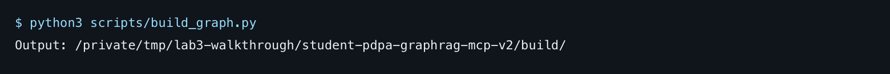
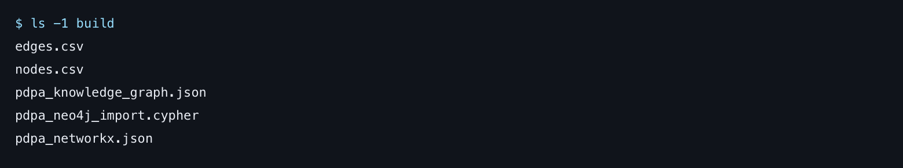
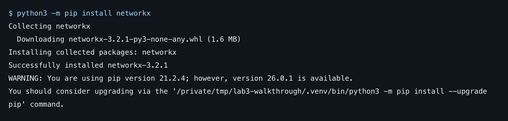
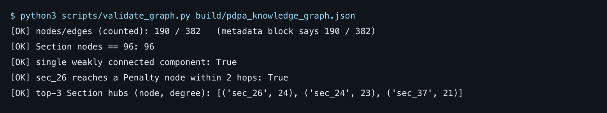
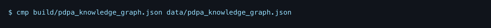

# LAB 3 ทำตามสไลด์ทีละขั้น พร้อมผลที่ได้

เอกสารนี้แสดงผลของการทำ LAB 3 ตามสไลด์ M1 หน้า "Hands-on LAB 3: สร้าง Knowledge Graph" ทุกขั้น ใช้เทียบกับผลบนเครื่องของคุณได้

- **ทำเมื่อ:** 25 พ.ย. 2569 บน macOS 27.0.1 ด้วย Python 3.9.6 จาก commit [`d74bf9c`](https://github.com/aekanun2020/student-pdpa-graphrag-mcp-v2/commit/d74bf9c) ของ repo นี้
- **ยังไม่ได้ทดสอบบน Windows**
- **ภาพในเอกสารนี้สร้างจากข้อความที่ terminal พิมพ์ออกมาจริง ไม่ใช่ภาพถ่ายหน้าจอ**
- **Python ที่ใช้:** รันใน virtual environment ใหม่ที่ยังไม่มี `networkx`

LAB นี้ไม่ต้องเปิด server สคริปต์สร้างกราฟลงโฟลเดอร์ `build/` แล้วให้ตรวจและเทียบกับกราฟที่ใช้จริงใน `data/`

## 1. เตรียมโฟลเดอร์ของ repo

สไลด์ให้รันจากโฟลเดอร์ของ repo เดียวกับ LAB 2 ถ้ามีอยู่แล้ว ข้ามข้อนี้

```sh
git clone https://github.com/aekanun2020/student-pdpa-graphrag-mcp-v2.git
cd student-pdpa-graphrag-mcp-v2
```



## 2. สร้างกราฟ

```sh
python3 scripts/build_graph.py
```

ผลยาว จึงแบ่งเป็น 3 ภาพเรียงตามลำดับ ทุกบรรทัดอยู่ครบ







บรรทัด `Output:` แสดง path ของโฟลเดอร์ `build/` บนเครื่องที่รัน บนเครื่องของคุณ path ส่วนหน้าจะต่างจากในภาพ

### ดูไฟล์ที่สร้างขึ้น

คำสั่งนี้เป็นคำสั่งตรวจเพิ่ม ไม่ได้อยู่ในสไลด์

```sh
ls -1 build
```



## 3. ติดตั้ง networkx และตรวจกราฟที่สร้าง

```sh
python3 -m pip install networkx
```



```sh
python3 scripts/validate_graph.py build/pdpa_knowledge_graph.json
```



ตัวตรวจนี้เป็นการตรวจเบื้องต้น มีเงื่อนไข 3 ข้อ คือ โหนดชนิด `Section` ต้องมี 96 ตัว กราฟต้องต่อถึงกันทั้งหมด และจากมาตรา 26 ต้องเดินถึงโหนดโทษได้ภายใน 2 hop บรรทัดแรกและบรรทัดสุดท้ายแสดงข้อมูลเท่านั้น จึงขึ้น `[OK]` เสมอ

ตัวตรวจไม่ได้ตรวจว่าชนิดของโหนด ประเภทของเส้น และ property ตรงตาม schema เช่น ถ้าสะกดชื่อประเภทเส้นผิด ผลยังขึ้น `[OK]` ครบทุกบรรทัด การยืนยันว่ากราฟที่สร้างตรงกับกราฟที่ใช้จริงทั้งไฟล์ อยู่ที่ขั้นถัดไป คือคำสั่ง `cmp`

## 4. เทียบกับกราฟที่ใช้จริง

```sh
cmp build/pdpa_knowledge_graph.json data/pdpa_knowledge_graph.json
```



คำสั่ง `cmp` ไม่พิมพ์อะไร ภาพจึงมีเฉพาะบรรทัดคำสั่ง แปลว่าไฟล์ทั้งสองตรงกันทุกไบต์

## 5. เทียบกับผลที่สไลด์ระบุ

| รายการ | สไลด์บอกว่า | ได้จริง | ดูได้ที่ |
|---|---|---|---|
| จำนวนไฟล์ที่เขียน | 5 ไฟล์ | 5 ไฟล์ | ข้อ 2 รายชื่อไฟล์ |
| โฟลเดอร์ปลายทาง | `build/` | `build/` | ข้อ 2 บรรทัด `Output:` |
| ไฟล์ใน `data/` | ไม่ถูกทับ | SHA-256 ของ `data/pdpa_knowledge_graph.json` ก่อนและหลังรันเท่ากัน | ไม่มีภาพ |
| Total Nodes | 190 | 190 | ข้อ 2 ภาพส่วนที่ 1 |
| Total Edges | 382 | 382 | ข้อ 2 ภาพส่วนที่ 1 |
| ผลตรวจ | ทุกบรรทัดขึ้น `[OK]` | 5 จาก 5 บรรทัดขึ้น `[OK]` | ข้อ 3 |
| เทียบด้วย `cmp` | ไม่พิมพ์อะไร | ไม่พิมพ์อะไร | ข้อ 4 |

ผลตรงกับสไลด์ทุกรายการ

## สำหรับ Windows (ยังไม่ได้ทดสอบ)

ขั้นตอนในหัวข้อนี้เขียนจากความรู้ทั่วไปเรื่อง Git for Windows ยังไม่ได้ทดสอบบนเครื่อง Windows จริง ถ้าผลบนเครื่องของคุณต่างจากที่เขียนไว้ ให้แจ้งผู้สอน

Command Prompt ของ Windows ไม่มีคำสั่ง `cmp` ให้ใช้โปรแกรม Git Bash ซึ่งติดตั้งมาพร้อม Git แทน Command Prompt แล้วพิมพ์คำสั่งเดิมใน Git Bash

1. เปิดเมนู Start พิมพ์ `Git Bash` แล้วเปิดโปรแกรม
2. เข้าโฟลเดอร์ของ repo ด้วยคำสั่ง `cd` ตามด้วย path ที่ clone ไว้ เช่น `cd ~/student-pdpa-graphrag-mcp-v2`
3. รันคำสั่งของ LAB 3 ตามลำดับเดิม โดยใช้ `python` แทน `python3`

```sh
python scripts/build_graph.py
python -m pip install networkx
python scripts/validate_graph.py build/pdpa_knowledge_graph.json
cmp build/pdpa_knowledge_graph.json data/pdpa_knowledge_graph.json
```

ผลของ 3 คำสั่งแรกควรตรงกับภาพในข้อ 2 และ 3

**ข้อควรรู้เรื่อง `cmp` บน Windows:** ถ้า `cmp` พิมพ์ว่าไฟล์ต่างกัน (มีคำว่า `differ`) ทั้งที่ผลของคำสั่งอื่นตรงกับเอกสารนี้ สาเหตุที่เป็นไปได้คือรูปแบบท้ายบรรทัดของไฟล์ ไม่ใช่กราฟผิด บน Windows สคริปต์เขียนไฟล์ด้วยท้ายบรรทัดแบบ Windows (CRLF) ส่วนไฟล์ใน `data/` อาจมีท้ายบรรทัดแบบ LF หรือ CRLF ขึ้นกับการตั้งค่า `core.autocrlf` ของ Git ตอน clone ข้อนี้เป็นการคาด ยังไม่ได้ทดสอบ
