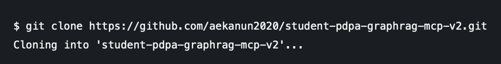
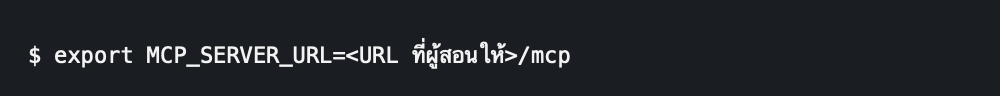
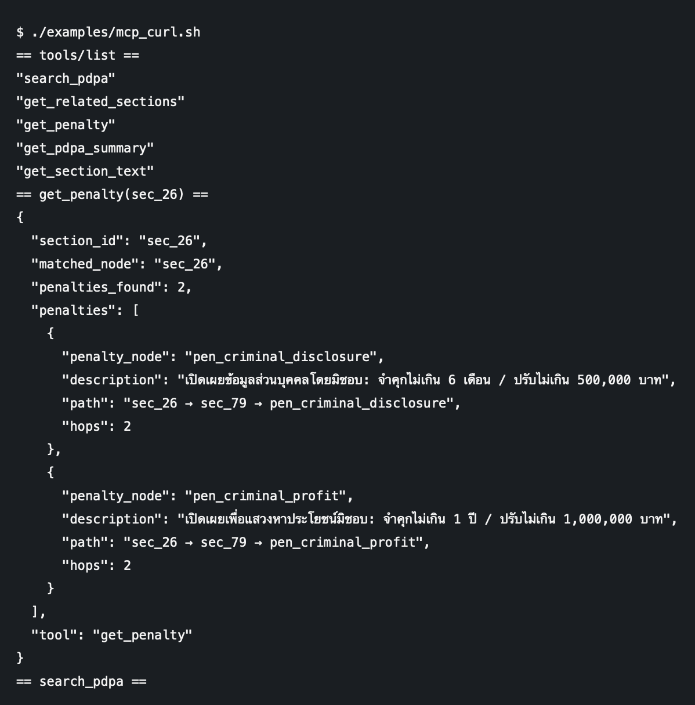

# LAB 4 ทำตามสไลด์ทีละขั้น พร้อมผลที่ได้

เอกสารนี้แสดงผลของการทำ LAB 4 ตามสไลด์ M2 หน้า "Hands-on LAB 4: ทดสอบ MCP Tools ด้วย curl" ทุกขั้น ใช้เทียบกับผลบนเครื่องของคุณได้

- **ทำเมื่อ:** 25 พ.ย. 2569 บน macOS 27.0.1 ด้วย curl 8.7.1 และ jq 1.7.1 จาก commit [`cd7c942`](https://github.com/aekanun2020/student-pdpa-graphrag-mcp-v2/commit/cd7c942) ของ repo นี้
- **MCP server ที่ใช้:** server ที่ผู้สอนเปิดให้ ในเอกสารและภาพเขียน URL เป็น `<URL ที่ผู้สอนให้>`
- **ยังไม่ได้ทดสอบบน Windows**
- **ภาพในเอกสารนี้สร้างจากข้อความที่ terminal พิมพ์ออกมาจริง ไม่ใช่ภาพถ่ายหน้าจอ**
- **ผลของแต่ละรอบต่างกันได้:** คีย์เวิร์ดมาจาก LLM ซึ่งไม่คงที่ คีย์เวิร์ดในเอกสารนี้จึงเป็นของรอบที่ทำ ไม่ใช่ค่าที่เครื่องของคุณต้องได้ตรงกัน

LAB นี้คุยกับ MCP server โดยตรงด้วย `curl` ไม่ผ่าน agent และไม่แก้ไฟล์ใดใน repo

## 1. เตรียมโฟลเดอร์ของ repo และตั้งค่า server

ถ้ามีโฟลเดอร์ของ repo จาก LAB ก่อนหน้าแล้ว ข้ามคำสั่ง `git clone`

```sh
git clone https://github.com/aekanun2020/student-pdpa-graphrag-mcp-v2.git
cd student-pdpa-graphrag-mcp-v2
```



ถ้าใช้ server ที่ผู้สอนเปิดให้ ตั้งค่า URL 1 ครั้งใน terminal ที่จะใช้ทำ LAB ถ้าใช้ server ที่รันเองตาม LAB 1 ข้ามคำสั่งนี้

```sh
export MCP_SERVER_URL=<URL ที่ผู้สอนให้>/mcp
```



คำสั่งนี้ไม่พิมพ์อะไร ภาพจึงมีเฉพาะบรรทัดคำสั่ง

## 2. รันสคริปต์

```sh
./examples/mcp_curl.sh
```

ผลยาว จึงแบ่งเป็น 2 ภาพเรียงตามลำดับ ทุกบรรทัดอยู่ครบ ภาพที่ 2 ขึ้นต้นด้วยบรรทัดคำสั่งเดิม เพื่อบอกว่าเป็นผลของคำสั่งเดียวกัน




รอบนี้ได้ชื่อ tool 5 ตัว โทษของ `sec_26` 2 รายการ และ keywords ที่มี `low_level` 7 คำ กับ `high_level` 6 คำ

## 3. เทียบกับผลที่สไลด์ระบุ

| รายการ | สไลด์บอกว่า | ได้จริง | ดูได้ที่ |
|---|---|---|---|
| จำนวน tool | 5 ตัว | 5 ตัว | ข้อ 2 ภาพส่วนที่ 1 |
| โทษของ `sec_26` | 2 รายการ | 2 รายการ | ข้อ 2 ภาพส่วนที่ 1 |
| keywords | มี keywords | `low_level` 7 คำ และ `high_level` 6 คำ | ข้อ 2 ภาพส่วนที่ 2 |

ผลตรงกับสไลด์หน้า LAB 4 ทุกรายการ

## สำหรับ Windows (ยังไม่ได้ทดสอบ)

บน Windows ไม่ต้องใช้ `curl`, `jq` และ Git Bash ให้รันสคริปต์ Python นี้แทนคำสั่งในข้อ 1 และข้อ 2 จากโฟลเดอร์ของ repo

```sh
python labs/lab4/call_tools.py --url <URL ที่ผู้สอนให้>/mcp
```

ถ้าใช้ server ที่รันเองตาม LAB 1 ไม่ต้องใส่ `--url`

สคริปต์นี้ทดสอบบน macOS เมื่อ 26 พ.ย. 2569 ด้วย Python 3.12.7 กับ server ที่ผู้สอนเปิดให้ ผลของ `tools/list` และ `get_penalty` ตรงกับภาพส่วนที่ 1 ในข้อ 2 ทุกบรรทัด
และส่วน `search_pdpa` ได้ `low_level` 7 คำ กับ `high_level` 6 คำ **ยังไม่ได้ทดสอบบนเครื่อง Windows จริง** ถ้าผลบนเครื่องของคุณต่างจากที่เขียนไว้ ให้แจ้งผู้สอน
