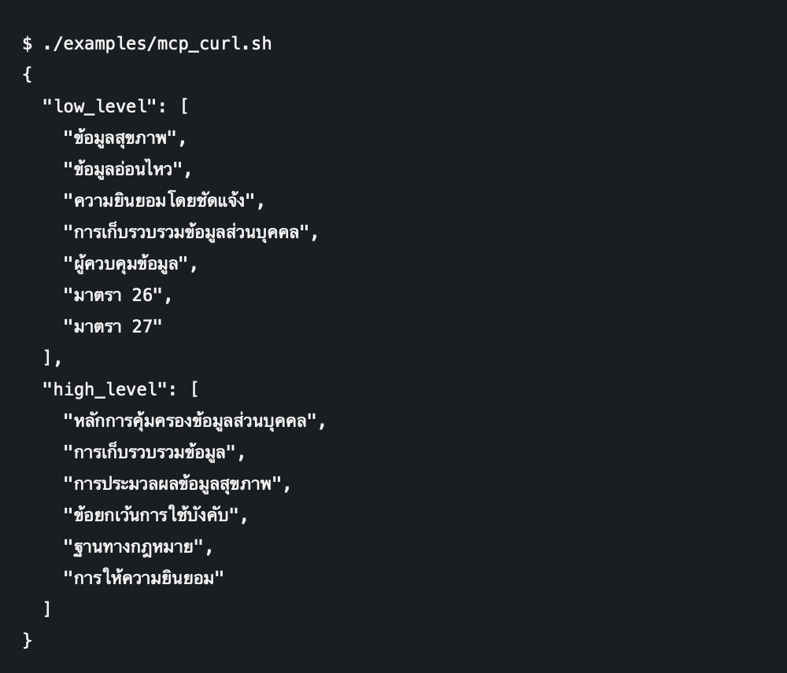
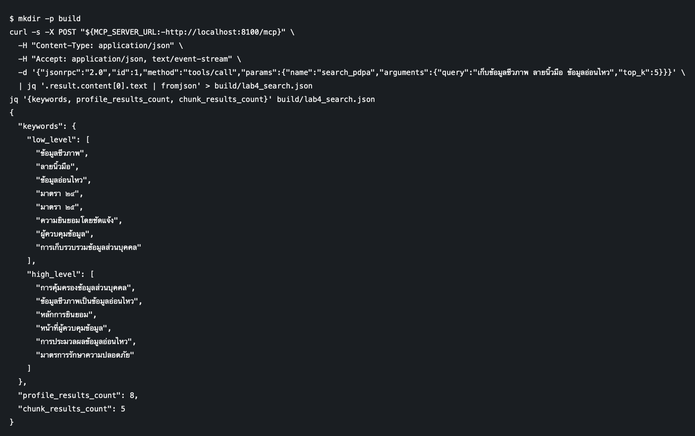
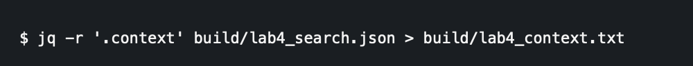
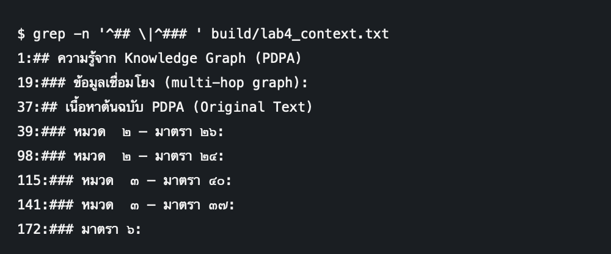

# LAB 4 ทำตามสไลด์ทีละขั้น พร้อมผลที่ได้

เอกสารนี้แสดงผลของการทำ LAB 4 ตามสไลด์ M2 หน้า "Hands-on LAB 4: ทดสอบ MCP Tools ด้วย curl" ทุกขั้น ใช้เทียบกับผลบนเครื่องของคุณได้

- **ทำเมื่อ:** 25 พ.ย. 2569 บน macOS 27.0.1 ด้วย curl 8.7.1 และ jq 1.7.1 จาก commit [`cd7c942`](https://github.com/aekanun2020/student-pdpa-graphrag-mcp-v2/commit/cd7c942) ของ repo นี้
- **MCP server ที่ใช้:** server ที่ผู้สอนเปิดให้ ในเอกสารและภาพเขียน URL เป็น `<URL ที่ผู้สอนให้>`
- **ยังไม่ได้ทดสอบบน Windows**
- **ภาพในเอกสารนี้สร้างจากข้อความที่ terminal พิมพ์ออกมาจริง ไม่ใช่ภาพถ่ายหน้าจอ**
- **ผลของแต่ละรอบต่างกันได้:** คีย์เวิร์ดมาจาก LLM ซึ่งไม่คงที่ คีย์เวิร์ด จำนวน profile เลขมาตรา และเลขบรรทัดในเอกสารนี้จึงเป็นของรอบที่ทำ ไม่ใช่ค่าที่เครื่องของคุณต้องได้ตรงกัน

LAB นี้คุยกับ MCP server โดยตรงด้วย `curl` ไม่ผ่าน agent และไม่แก้ไฟล์ใดใน repo

## 1. เตรียมโฟลเดอร์ของ repo และตั้งค่า server

ถ้ามีโฟลเดอร์ของ repo จาก LAB ก่อนหน้าแล้ว ข้ามคำสั่ง `git clone`

```sh
git clone https://github.com/aekanun2020/student-pdpa-graphrag-mcp-v2.git
cd student-pdpa-graphrag-mcp-v2
```


ถ้าใช้ server ที่ผู้สอนเปิดให้ ตั้งค่า URL 1 ครั้งใน terminal ที่จะใช้ทำ LAB ถ้าใช้ server ที่รันเองตาม LAB 1 ข้ามคำสั่งนี้

```sh
export MCP_SERVER_URL=<URL ที่ผู้สอนให้>/mcp
```


คำสั่งนี้ไม่พิมพ์อะไร ภาพจึงมีเฉพาะบรรทัดคำสั่ง

## 2. รันสคริปต์

```sh
./examples/mcp_curl.sh
```

ผลยาว จึงแบ่งเป็น 2 ภาพเรียงตามลำดับ ทุกบรรทัดอยู่ครบ ภาพที่ 2 ขึ้นต้นด้วยบรรทัดคำสั่งเดิม เพื่อบอกว่าเป็นผลของคำสั่งเดียวกัน




รอบนี้ได้ชื่อ tool 5 ตัว โทษของ `sec_26` 2 รายการ และ keywords ที่มี `low_level` 7 คำ กับ `high_level` 6 คำ

## 3. เรียก search_pdpa เอง แล้วเก็บผลลงไฟล์

คำสั่งนี้คัดจาก README หัวข้อ [LAB 4](../README.md#lab-4-ทดสอบ-mcp-tools-ด้วย-curl) ขั้นที่ 2

```sh
mkdir -p build
curl -s -X POST "${MCP_SERVER_URL:-http://localhost:8100/mcp}" \
  -H "Content-Type: application/json" \
  -H "Accept: application/json, text/event-stream" \
  -d '{"jsonrpc":"2.0","id":1,"method":"tools/call","params":{"name":"search_pdpa","arguments":{"query":"เก็บข้อมูลชีวภาพ ลายนิ้วมือ ข้อมูลอ่อนไหว","top_k":5}}}' \
  | jq '.result.content[0].text | fromjson' > build/lab4_search.json
jq '{keywords, profile_results_count, chunk_results_count}' build/lab4_search.json
```



คำสั่ง `curl` เขียนผลทั้งก้อนลง `build/lab4_search.json` และไม่พิมพ์อะไร ภาพแสดงคำสั่งครบทุกบรรทัด ตามด้วยผลของคำสั่ง `jq` บรรทัดสุดท้าย

รอบนี้ได้ `low_level` 8 คำ `high_level` 6 คำ `profile_results_count` 8 และ `chunk_results_count` 5 คำสั่ง `curl` ใช้เวลาประมาณ 4 วินาที

ทั้งผลของสคริปต์ในข้อ 2 และผลในข้อนี้ `low_level` ไม่ใช่คำถามเดิม และ `high_level` ไม่ว่าง จึงไม่ต้องรันซ้ำตามข้อ 4 ของสไลด์

## 4. ดู 3 ส่วนของ context

คำสั่งนี้คัดจาก README หัวข้อ LAB 4 ขั้นที่ 3 ขั้นนี้ไม่เรียก server เพิ่ม

```sh
jq -r '.context' build/lab4_search.json > build/lab4_context.txt
```



คำสั่งนี้เขียนไฟล์ `build/lab4_context.txt` และไม่พิมพ์อะไร ภาพจึงมีเฉพาะบรรทัดคำสั่ง

```sh
grep -n '^## \|^### ' build/lab4_context.txt
```



รอบนี้ส่วนที่ 1 (profile ที่ค้นเจอ) เริ่มที่บรรทัด 1 ส่วนที่ 2 (ผลเดินกราฟ) เริ่มที่บรรทัด 19 และส่วนที่ 3 (ตัวบทเต็ม) เริ่มที่บรรทัด 37 ตัวบทเต็มมี 5 มาตรา เรียงเป็น 26, 24, 40, 37 และ 6

บรรทัด `[hop1]` และ `[hop2]` อยู่ใต้หัวข้อของส่วนที่ 2 เปิดไฟล์ `build/lab4_context.txt` ดูได้ วิธีอ่านบรรทัดเหล่านี้อยู่ใน README หัวข้อ LAB 4 ขั้นที่ 3

## 5. เทียบกับผลที่สไลด์ระบุ

| รายการ | สไลด์บอกว่า | ได้จริง | ดูได้ที่ |
|---|---|---|---|
| จำนวน tool | 5 ตัว | 5 ตัว | ข้อ 2 ภาพส่วนที่ 1 |
| โทษของ `sec_26` | 2 รายการ | 2 รายการ | ข้อ 2 ภาพส่วนที่ 1 |
| keywords | มี keywords | `low_level` 7 คำ และ `high_level` 6 คำ | ข้อ 2 ภาพส่วนที่ 2 |
| ไฟล์ผล | `build/lab4_search.json` | สร้างไฟล์ได้ | ข้อ 3 |
| กรณีที่ต้องรันซ้ำ | `low_level` เป็นคำถามเดิมและ `high_level` ว่าง | ไม่พบกรณีนี้ | ข้อ 2 และข้อ 3 |
| ส่วนของ context | profile ที่ค้นเจอ ผลเดินกราฟ และตัวบทเต็ม | ครบ 3 ส่วน | ข้อ 4 |

ผลตรงกับสไลด์หน้า LAB 4 ทุกรายการ

สไลด์หน้า "ตัวอย่างผลของ LAB 4" แสดงผลของอีกรอบหนึ่ง ซึ่งได้ profile 7 รายการ และตัวบทเต็มของมาตรา 26, 24, 25, 19 และ 32 ต่างจากรอบในเอกสารนี้ ทั้งที่ใช้คำค้นเดียวกัน

## สำหรับ Windows (ยังไม่ได้ทดสอบ)

สไลด์ให้รันทุกข้อของ LAB นี้ใน Git Bash เอกสารนี้ทำบน macOS เท่านั้น ยังไม่ได้ทดสอบบนเครื่อง Windows จริง ถ้าผลบนเครื่องของคุณต่างจากที่เขียนไว้ ให้แจ้งผู้สอน
