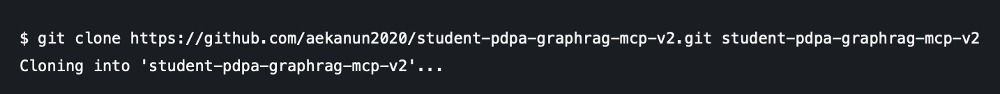
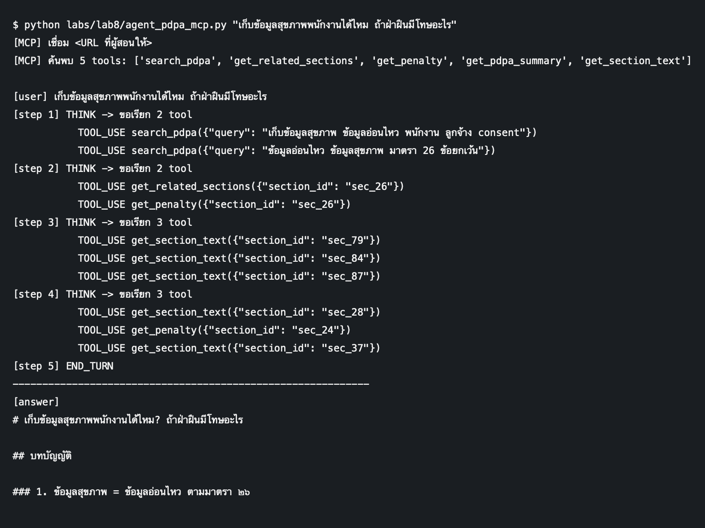
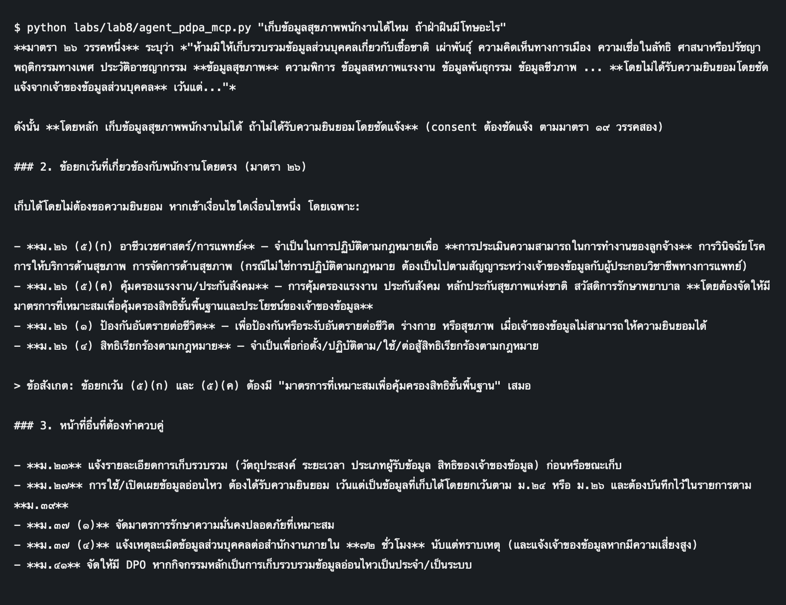
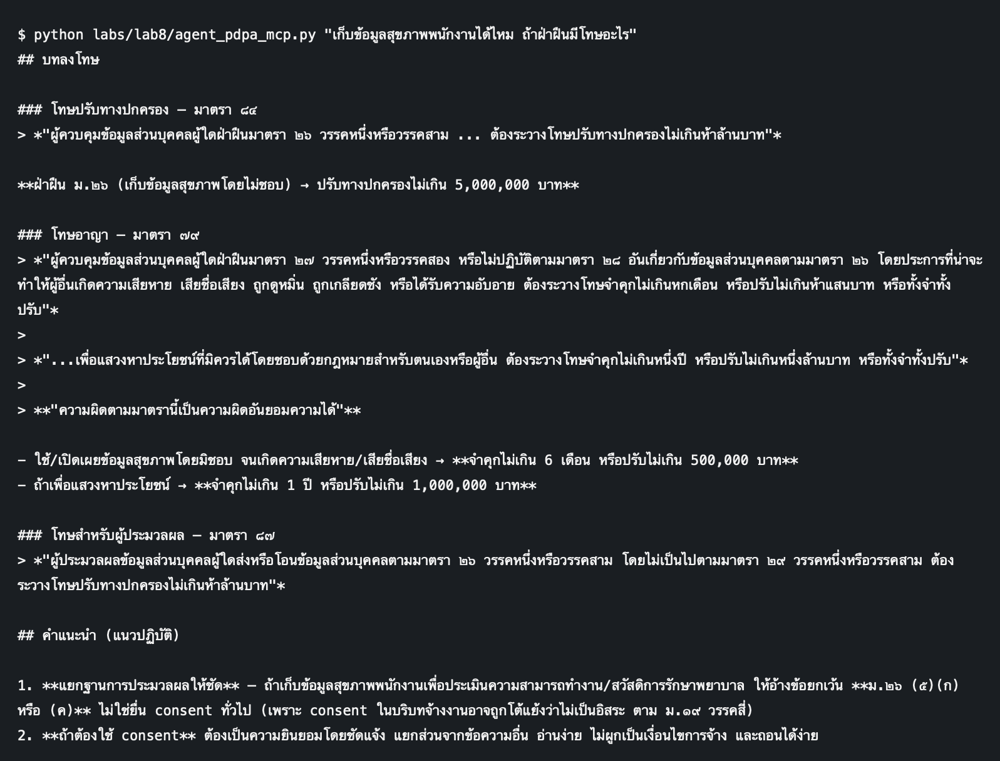
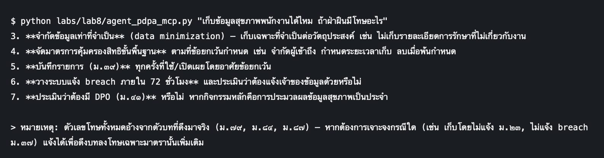

# LAB 5 ทำตามสไลด์ทีละขั้น พร้อมผลที่ได้

เอกสารนี้แสดงผลของการทำ LAB 5 ตามสไลด์ M3 หน้า "LAB 5: สร้าง Agent ที่เชื่อมต่อกับ MCP Server จาก PART 2" ทุกขั้น ใช้เทียบกับผลบนเครื่องของคุณได้

- **ทำเมื่อ:** 26 พ.ย. 2569 บน macOS 27.0.1 ด้วย Python 3.12.7 จาก commit [`99e94b4`](https://github.com/aekanun2020/student-pdpa-graphrag-mcp-v2/commit/99e94b4) ของ repo นี้
- **MCP server ที่ใช้:** server ที่ผู้สอนเปิดให้ ในเอกสารและภาพเขียน URL เป็น `<URL ที่ผู้สอนให้>`
- **ยังไม่ได้ทดสอบบน Windows**
- **ภาพในเอกสารนี้สร้างจากข้อความที่ terminal พิมพ์ออกมาจริง ไม่ใช่ภาพถ่ายหน้าจอ**
- **ผลของแต่ละรอบต่างกันได้:** จำนวนรอบ tool ที่ถูกเรียก และข้อความของคำตอบ ขึ้นกับโมเดล ผลในเอกสารนี้จึงเป็นของรอบที่ทำ ไม่ใช่ค่าที่เครื่องของคุณต้องได้ตรงกัน

LAB นี้รัน agent ใน `labs/lab8/agent_pdpa_mcp.py` และไม่แก้ไฟล์โค้ดใดใน repo

## 1. เตรียมโฟลเดอร์ของ repo

ถ้ามีโฟลเดอร์ของ repo จาก LAB ก่อนหน้าแล้ว ข้ามคำสั่ง `git clone`

```sh
git clone https://github.com/aekanun2020/student-pdpa-graphrag-mcp-v2.git student-pdpa-graphrag-mcp-v2
cd student-pdpa-graphrag-mcp-v2
```



## 2. เตรียมไฟล์ .env

ถ้ามีไฟล์ `.env` จาก LAB 1 แล้ว ข้ามคำสั่ง `cp`

```sh
cp .env.example .env
```


คำสั่งนี้ไม่พิมพ์อะไร ภาพจึงมีเฉพาะบรรทัดคำสั่ง

เปิดไฟล์ `.env` แล้วใส่ค่า 2 บรรทัดนี้ ค่าจริงไม่แสดงในเอกสารและในภาพ

```dotenv
OPENROUTER_API_KEY=<key ของคุณ>
MCP_SERVER_URL=<URL ที่ผู้สอนให้>/mcp
```

ถ้าใช้ server ที่รันเองตาม LAB 1 ไม่ต้องแก้บรรทัด `MCP_SERVER_URL`

## 3. สร้าง venv และติดตั้งไลบรารี

```sh
python -m venv .venv && source .venv/bin/activate
```


คำสั่งนี้ไม่พิมพ์อะไร ภาพจึงมีเฉพาะบรรทัดคำสั่ง

```sh
pip install -r requirements-agent.txt
```

คำสั่งนี้พิมพ์รายการไลบรารีที่ติดตั้งยาวหลายสิบบรรทัด เอกสารนี้ไม่แสดงภาพของผล รอบนี้คำสั่งจบโดยไม่มีข้อความผิดพลาด

## 4. รัน agent

```sh
python labs/lab8/agent_pdpa_mcp.py "เก็บข้อมูลสุขภาพพนักงานได้ไหม ถ้าฝ่าฝืนมีโทษอะไร"
```

ผลยาว จึงแบ่งเป็น 4 ภาพเรียงตามลำดับ ทุกบรรทัดอยู่ครบ แต่ละภาพขึ้นต้นด้วยบรรทัดคำสั่งเดิม เพื่อบอกว่าเป็นผลของคำสั่งเดียวกัน









รอบนี้ใช้ประมาณ 38 วินาที agent เรียก tool 4 รอบ รวม 10 ครั้ง คือ `search_pdpa` 2 ครั้ง `get_related_sections` 1 ครั้ง `get_penalty` 2 ครั้ง และ `get_section_text` 5 ครั้ง แล้วตอบในรอบที่ 5

เอกสารนี้ไม่ได้ตรวจว่าคำตอบของ agent ถูกต้องทางกฎหมายหรือไม่

## 5. เทียบกับผลที่สไลด์และ README ระบุ

| รายการ | สไลด์หรือ README บอกว่า | ได้จริง | ดูได้ที่ |
|---|---|---|---|
| คำสั่ง 3 บรรทัด | สร้าง venv ติดตั้งไลบรารี และรัน agent | รันตามสไลด์ได้ทั้ง 3 คำสั่ง ไม่ต้องแก้คำสั่ง | ข้อ 3 และข้อ 4 |
| รายการ tool | `[MCP] ค้นพบ 5 tools` | พบ 5 tools | ข้อ 4 ภาพส่วนที่ 1 |
| การเรียก tool | มีบรรทัด `[step n] THINK` กับ `TOOL_USE` | มี `THINK` 4 รอบ เรียก tool รวม 10 ครั้ง | ข้อ 4 ภาพส่วนที่ 1 |
| จบการทำงาน | `[step n] END_TURN` | `[step 5] END_TURN` | ข้อ 4 ภาพส่วนที่ 1 |
| คำตอบ | อยู่ใต้บรรทัด `[answer]` | มีคำตอบใต้บรรทัดนี้ | ข้อ 4 ภาพส่วนที่ 1 ถึง 4 |
| จำนวนรอบสูงสุด | agent วนได้ไม่เกิน 8 รอบ | จบที่รอบที่ 5 ไม่พบข้อความถึงขีดจำกัด | ข้อ 4 ภาพส่วนที่ 1 |

ผลตรงกับสไลด์หน้า LAB 5 และ README ทุกรายการ

## สำหรับ Windows (ยังไม่ได้ทดสอบ)

บน Windows ใช้ Git Bash และเปลี่ยนบรรทัดแรกของข้อ 3 เป็นคำสั่งนี้ **ยังไม่ได้ทดสอบบนเครื่อง Windows จริง** ถ้าผลบนเครื่องของคุณต่างจากที่เขียนไว้ ให้แจ้งผู้สอน

```sh
python -m venv .venv && source .venv/Scripts/activate
```
